# Exercise 5 – Messaging Platforms: Fundamentals

**Student:** Hendrik Mertens

---

## Part 1 – Kafka quick start (guided, not graded)

### Step 1 – A topic is a set of logs

```bash
docker exec -it kafka kafka-topics.sh --bootstrap-server localhost:9092 \
  --create --topic clicks --partitions 2 --replication-factor 1
```

```text
Created topic clicks.
```

```bash
docker exec -it kafka kafka-topics.sh --bootstrap-server localhost:9092 \
  --describe --topic clicks
```

```text
Topic: clicks   TopicId: ULEBQrIaSomcP3QAAWYCvw   PartitionCount: 2   ReplicationFactor: 1   Configs: min.insync.replicas=1
    Topic: clicks   Partition: 0   Leader: 1   Replicas: 1   Isr: 1
    Topic: clicks   Partition: 1   Leader: 1   Replicas: 1   Isr: 1
```

The topic `clicks` has two partitions (0 and 1): two append-only logs. Both are on broker 1, with one replica each, because we run a single broker.

### Step 2 – Keys decide the partition

> **Prediction:** I thought that `user-1` would land in a different partition on each run, and that events without a key would all land in the same partition.

**Result:** my prediction was wrong.

- After running `python3 producer.py` twice, all `user-1` events are in **partition 0** on both runs.
- Partition 0 only contains `user-1` and `user-2`; partition 1 only contains `user-3` and `user-4`.
- The partition is `hash(key) mod number of partitions`, so the same key always goes to the same partition, and the order per key is preserved.

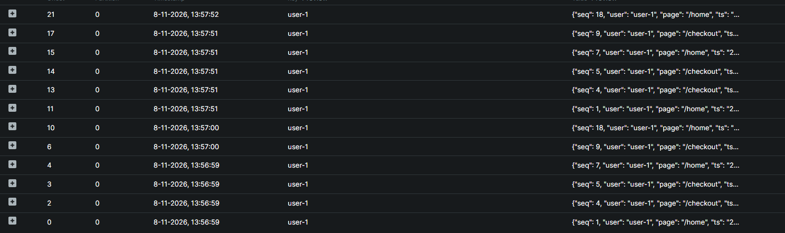

With `python3 producer.py --no-key`, the events are spread over **both** partitions. The order per user is lost.

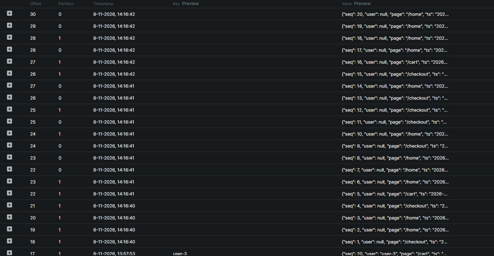

### Step 3 – Consumer groups share the work

> **Prediction:** I thought the events would be evenly divided over the three consumers.

```bash
python3 consumer.py --group dashboard --name A
python3 consumer.py --group dashboard --name B
python3 consumer.py --group dashboard --name C
```

| Consumer A | Consumer B | Consumer C |
|---|---|---|
| 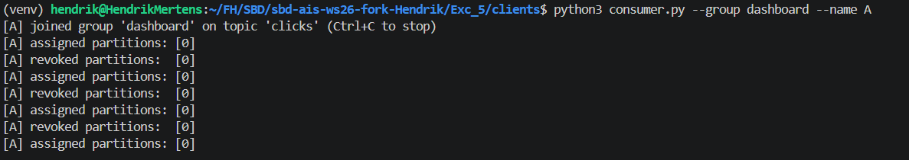 | 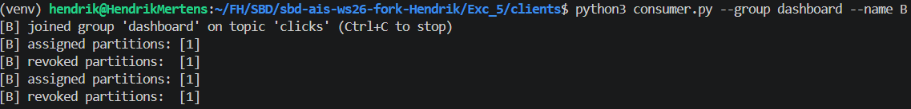 | 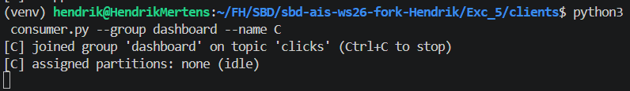 |

- Consumer **A** gets partition 0, consumer **B** gets partition 1.
- Consumer **C** gets no partition (`assigned partitions: none (idle)`). Within one group, a partition is read by only one consumer, and there are only two partitions. More consumers than partitions do not help.
- Every time a consumer joins or leaves, the group **rebalances** (`revoked` / `assigned` in the output).

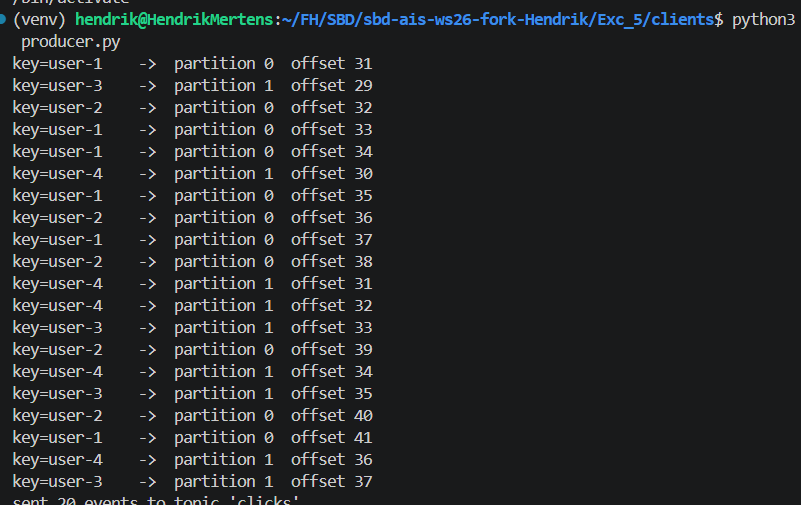
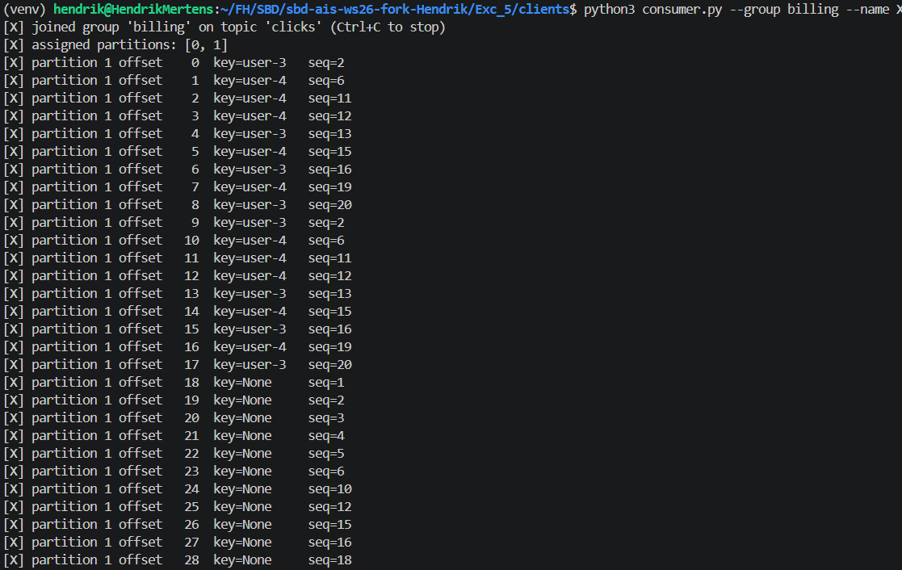

- After sending new events, A (partition 0) only reads `user-1` and `user-2`, and B (partition 1) only reads `user-3` and `user-4`. Events without a key end up in both partitions.
- Consumer **X** in the second group `billing` gets **both** partitions (0 and 1), reads **all** keys, and starts at **offset 0**, so it also reads the old events.
- Starting X causes **no rebalance** in `dashboard`: A, B and C keep their partitions. Each group has its own offsets and reads the topic independently.

### Step 4 – Offsets: where a group continues

> **Prediction:** I thought that when A comes back, it would read all events again from offset 0.

**Result:** my prediction was wrong.

While all consumers of `dashboard` were stopped, I sent 20 new events and described the group:

| Partition | CURRENT-OFFSET | LOG-END-OFFSET | LAG |
|---|---|---|---|
| 0 | 64 | 75 | 11 |
| 1 | 56 | 65 | 9 |

When A comes back:

- A gets **both** partitions (0 and 1), because B and C are no longer running.
- Per partition, A starts **exactly at `CURRENT-OFFSET`** (64 and 56), the position the group had stored in Kafka.
- A reads exactly the **lag**: 11 + 9 = **20 events**, the events sent while the group was stopped. It does not read old events again and misses nothing.

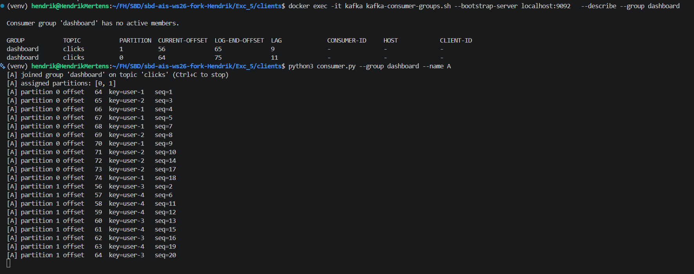

After A has caught up and is stopped again, `CURRENT-OFFSET` equals `LOG-END-OFFSET` and the lag is 0. If A were started again, it would read no events until new ones arrive.

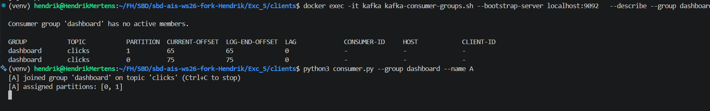

After `--reset-offsets --to-earliest` for `billing`, X starts at **offset 0** in both partitions and reads the whole topic again. The reset only changes the stored offsets of `billing`; `dashboard` is not affected.

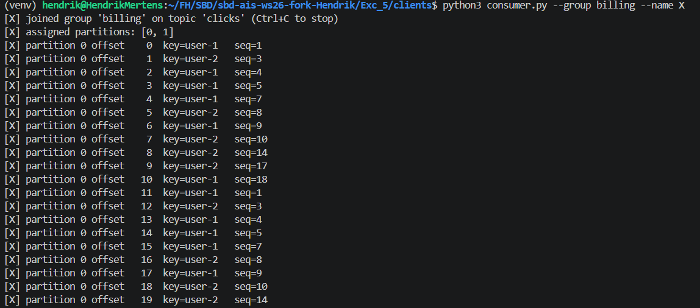
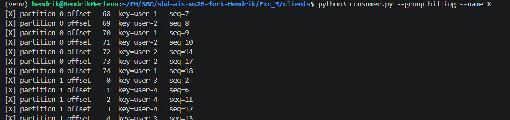

**Conclusion:** the committed offset is stored **per group and per partition in Kafka**, not in the consumer. Reading deletes nothing, so a reset or a new group can reprocess the history without affecting other groups.

---

## Part 2 – *Line Guardian*: predictive maintenance (graded)

### Stage A – Today's system

#### A1 – 20 machines: why does `missing` grow?

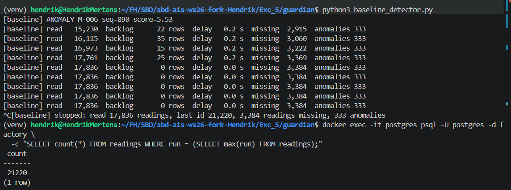

**Observation**

| | Value |
|---|---|
| Rows in the table (this run) | 21,220 |
| Read by the detector | 17,836 |
| Difference | 3,384 |
| `missing` reported by the detector | 3,384 |

The difference is exactly `missing`. **The missing readings are in the table**: the gateways stored them correctly, but the detector never read them. At the end the backlog is 0 and the delay is 0.0 s, so this is **not a speed problem**.

**Why the detector never saw them**

A row gets its `id` (BIGSERIAL) at the **INSERT**, but other connections only see it after the **COMMIT**. The 4 gateways write in parallel, and each gateway waits 0–120 ms between INSERT and COMMIT (`time.sleep(rng.uniform(0, 0.12))` in `PostgresSink`). As a result, rows do **not** become visible in the order of their ids.

**Timeline from the README**

| Time | Event | Visible to the detector |
|---|---|---|
| t₀ | Gateway 1 inserts ids 100–114 (not committed yet) | – |
| t₀ | Gateway 2 inserts ids 115–129 and commits at once | 115–129 |
| t₁ | Detector polls `WHERE id > 99` | reads 115–129, sets `last_id = 129` |
| t₀ + 100 ms | Gateway 1 commits | 100–114 become visible |
| t₂ | Detector polls `WHERE id > 129` | 100–114 are below 129: **never read** |

**Which rows does the detector see, and which `id` does it remember?** When it polls between the two commits, the detector only sees rows **115–129**. Rows 100–114 already exist and have their ids, but are not committed and therefore invisible to other connections. The detector remembers the highest id it read: **`last_id = 129`**. In the next poll it asks for `id > 129`, so rows 100–114, which are committed by then, are skipped forever and counted as `missing`.

This violates **R2**: the model does not get every reading of a machine.

#### A2 – Full plant (60 machines × 10 Hz)

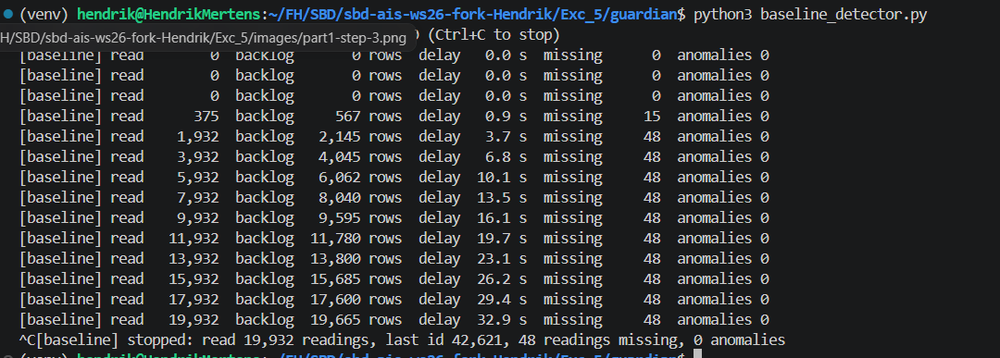

**Observation**

| | Behaviour while the plant runs |
|---|---|
| `backlog` | grows continuously: 0 → 567 → 2,145 → … → **19,665 rows** |
| `delay` | grows linearly: 0.9 s → 3.7 s → 6.8 s → … → **32.9 s** |
| `missing` | rises at the start (15 → 48), then stays at **48** |
| `anomalies` | **0**, although a fault started at t = 40 s |

**Why**

- **Backlog and delay:** the plant sends 60 × 10 Hz = **600 readings/s**. The model needs 3 ms per reading, so one detector handles at most 1 / 0.003 ≈ **333 readings/s**. About 270 more readings arrive per second than the detector can process. They are not lost, but they **queue up** in the table, so the backlog and the delay grow linearly without limit. The delay is roughly backlog / 600 (19,665 / 600 ≈ 33 s). After about 20 s it already exceeds the 5 s of **R3**.
- **0 anomalies:** the fault started at t = 40 s, but with ~33 s delay the detector had not reached those readings yet when the run was stopped. In reality, the bearing would break before an alert is raised.
- **Missing stops at 48:** at the start, the backlog is small and the detector reads rows right behind the newest ids, where uncommitted transactions still exist (the A1 problem). Once it falls far behind, it only reads rows that were committed long ago, so it no longer meets the gaps. The R2 problem is **hidden, not solved**: a faster detector would run into it again.

**Conclusion:** one polling detector fails **R1** and **R3** at 600 readings/s, and the polling with `id > last_id` fails **R2**.

### Stage B – Decision record

#### Context

PostgreSQL polling loses readings when several gateways commit in parallel (A1: 3,384 of 21,220 missing), and one detector cannot keep up with 600 readings/s (A2: delay ~33 s, 0 anomalies detected). The rollout targets 100,000 readings/s, plus a training-data archive and a live dashboard.

#### Options

| Option | R1 Scale | R2 Complete & ordered | R3 Fresh | R4 Independent consumers |
|---|---|---|---|---|
| **1. PostgreSQL, several pollers** | ⚠️ OK in the lab. At 100,000/s the single database must handle all inserts **and** all polls. | ❌ Parallel commits + `id > last_id` still create gaps. More pollers do not fix this. | ⚠️ Trade-off between polling interval and DB load. A safety lag to avoid gaps adds delay. | ❌ Archive and dashboard must also query PostgreSQL, which adds load and slows the others. |
| **2. Kafka** | ✅ Scales with partitions and consumer instances. | ✅ Key = `machine_id`: all readings of a machine go to one partition, in order. Offsets have no visibility gaps. | ✅ Consumers read new events directly from the log, no database polling, low latency. | ✅ Each consumer is its own group with its own offsets. No load on PostgreSQL. |

**Risks of option 2**

- Too few partitions limit parallelism (a topic created automatically by the first write has only 1).
- The model is stateful per machine: after a rebalance, a machine's state must be rebuilt or handled.
- A new consumer group must start at the right offset.
- Kafka is one more system to operate (but the group already runs it).

#### Decision

**Option 2:** the gateways write every reading to Kafka, keyed by `machine_id`. The detectors form one consumer group; the archive and the dashboard each use their own group. **PostgreSQL stays the system of record for the machine registry.**

#### Numbers

| | Calculation | Result |
|---|---|---|
| Capacity per instance | 1 / 0.003 s | ≈ **333 readings/s** |
| Lab (600/s) at 100 % load | 600 / 333 = 1.8 | **2 instances** |
| Lab with ~50 % headroom | 600 / (333 × 0.5) ≈ 3.6 | **4 instances**, at least 4 partitions (e.g. 6–8 for growth) |
| Rollout (100,000/s) at 100 % load | 100,000 / 333 ≈ 300 | **~300 instances** |
| Rollout with ~50 % headroom | 100,000 / (333 × 0.5) ≈ 600 | **~600 instances**, at least as many partitions |

Partitions should be planned up front: adding partitions later changes the key → partition mapping.

#### Tipping point

A small office with 1 reading per minute (~0.02 readings/s), one writer and one reader is perfectly served by PostgreSQL. Problems start around **tens to a few hundred readings/s**:

- several writers with overlapping transactions create gaps (R2);
- one poller reaches its limit (~333 readings/s here) (R1, R3);
- more than one consumer of the stream adds load to the database (R4).

Above that, a log-based platform such as Kafka is the better fit.