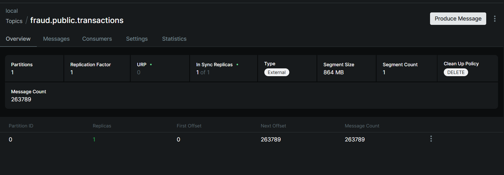
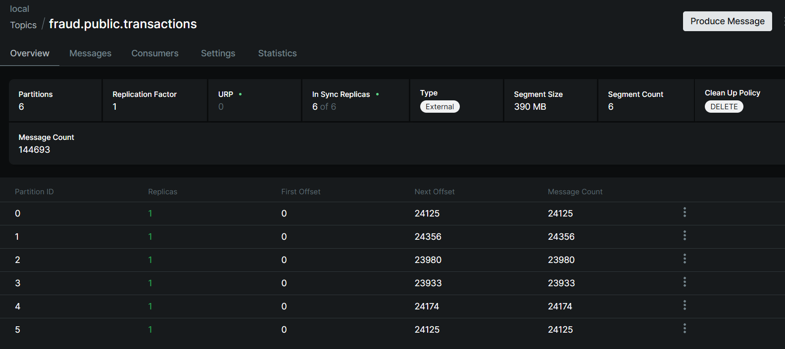
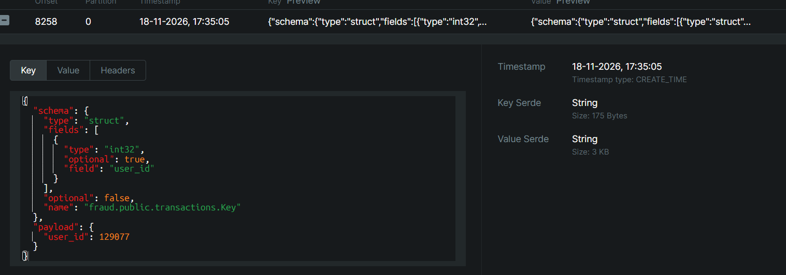

# Log Exercise 6 — *Card Sentinel*

**How to read this log**

| Block | Meaning |
|---|---|
| **▶ Input — T1/T2/T3** | what I typed in that terminal (`$` = prompt) |
| **◀ Output** | what the terminal returned |
| ▸ *collapsible* | long output (kept in full), click to open |

**Terminals:** T1 = connector + card processor · T2 = agents · T3 = scoreboard

## Summary of the results

| Run | Connector setting | Partitions | Key | Velocity assignment | Velocity R3 (caught) | Velocity R4 (p95) | Anomaly R3 | Anomaly R4 (p95) |
|---|---|---|---|---|---|---|---|---|
| 1 | defaults | 1 | `{"id": …}` | only vel-1 `[0]`, vel-2/vel-3 `[]` | 5/12 (42 %) **FAIL** | 124.1 s **FAIL** | 13/13 PASS | 16.7 s FAIL |
| 2 | + 6 partitions | 6 | `{"id": …}` | `[0,1]` `[2,3]` `[4,5]` | 0/11 (0 %) **FAIL** | no alerts, worst lag 6.9 s **FAIL** | 11/11 PASS | 42.7 s FAIL |
| 3 | + key = `user_id` | 6 | `{"user_id": …}` | `[0,1]` `[2,3]` `[4,5]` | 6/6 (100 %) **PASS** | 2.4 s **PASS** | 6/6 PASS | 2.2 s PASS |

> In Run 1 and Run 2, the R4 of **anomaly** fails too. At start-up ano-1 had a backlog of 24–47 s (the agents were started after the card processor) and only caught up after a few minutes. You can see this in the lag column of T2.

---

## 0. Setup

### 0.1 Pull the images and prepare Python

**▶ Input — T1**

```bash
$ docker compose pull
$ python3 -m venv venv
$ source venv/bin/activate
$ pip install --upgrade pip
$ pip install -r requirements.txt
```

**◀ Output (final state of `pull`; the intermediate spinner frames are omitted)**

```text
[+] Pulling 4/4
 ✔ kafka Pulled                                                                                                                       1.6s 
 ✔ connect Pulled                                                                                                                     1.3s 
 ✔ kafka-ui Pulled                                                                                                                    1.6s 
 ✔ postgres Pulled                                                                                                                    1.7s 

Requirement already satisfied: pip in ./venv/lib/python3.12/site-packages (26.3)
Requirement already satisfied: confluent-kafka==2.15.1 in ./venv/lib/python3.12/site-packages (from -r requirements.txt (line 2)) (2.15.1)
Requirement already satisfied: psycopg==3.3.6 in ./venv/lib/python3.12/site-packages (from psycopg[binary]==3.3.6->-r requirements.txt (line 3)) (3.3.6)
Requirement already satisfied: typing-extensions>=4.6 in ./venv/lib/python3.12/site-packages (from psycopg==3.3.6->psycopg[binary]==3.3.6->-r requirements.txt (line 3)) (4.16.0)
Requirement already satisfied: psycopg-binary==3.3.6 in ./venv/lib/python3.12/site-packages (from psycopg[binary]==3.3.6->-r requirements.txt (line 3)) (3.3.6)
```

### 0.2 Are the containers and Kafka Connect running?

**▶ Input — T1**

```bash
$ docker ps
```

**◀ Output (nothing was running yet at that moment)**

```text
CONTAINER ID   IMAGE     COMMAND   CREATED   STATUS    PORTS     NAMES
```

**▶ Input — T1**

```bash
$ curl -s localhost:8083/connector-plugins
```

**◀ Output (formatted: type and class of each plugin)**

```text
sink    io.debezium.connector.jdbc.JdbcSinkConnector
sink    io.debezium.connector.mongodb.MongoDbSinkConnector
source  io.debezium.connector.cockroachdb.CockroachDBConnector
source  io.debezium.connector.db2.Db2Connector
source  io.debezium.connector.db2as400.As400RpcConnector
source  io.debezium.connector.informix.InformixConnector
source  io.debezium.connector.mariadb.MariaDbConnector
source  io.debezium.connector.mongodb.MongoDbConnector
source  io.debezium.connector.mysql.MySqlConnector
source  io.debezium.connector.oracle.OracleConnector
source  io.debezium.connector.postgresql.PostgresConnector
source  io.debezium.connector.spanner.SpannerConnector
source  io.debezium.connector.sqlserver.SqlServerConnector
source  io.debezium.connector.vitess.VitessConnector
source  org.apache.kafka.connect.mirror.MirrorCheckpointConnector
source  org.apache.kafka.connect.mirror.MirrorHeartbeatConnector
source  org.apache.kafka.connect.mirror.MirrorSourceConnector
```

The Debezium **`PostgresConnector`** (version 3.3.2.Final) is in the list: Kafka Connect is ready.

---

## 1. Guide — Change Data Capture with Debezium

### 1.1 Create the database and the table (psql)

**▶ Input — T1**

```bash
$ docker exec -it postgres psql -U postgres
```

**◀ Output**

```text
psql (18.1 (Debian 18.1-1.pgdg13+2))
Type "help" for help.
```

**▶ Input — T1 (psql)**

```sql
CREATE DATABASE activity;
\c activity
CREATE TABLE activity (
  id SERIAL PRIMARY KEY,
  name VARCHAR(255) NOT NULL,
  email VARCHAR(255)
);
INSERT INTO activity(id, name) VALUES (1, 'Alice');
\q
```

**◀ Output**

```text
ERROR:  database "activity" already exists
You are now connected to database "activity" as user "postgres".
ERROR:  relation "activity" already exists
ERROR:  duplicate key value violates unique constraint "activity_pkey"
DETAIL:  Key (id)=(1) already exists.
```

> The database, the table and the row with Alice already existed from an earlier attempt, hence the errors. The event still ends up in the topic (see 1.3).

### 1.2 Register the Debezium connector

**▶ Input — T2**

```bash
$ curl -i -X POST -H "Content-Type: application/json" localhost:8083/connectors/ -d '{
  "name": "activity-connector",
  "config": {
    "connector.class": "io.debezium.connector.postgresql.PostgresConnector",
    "database.hostname": "postgres",
    "database.port": "5432",
    "database.user": "postgres",
    "database.password": "postgrespw",
    "database.dbname": "activity",
    "topic.prefix": "dbserver1",
    "plugin.name": "pgoutput",
    "slot.name": "activityslot"
  }
}'
```

**◀ Output**

```text
HTTP/1.1 201 Created
Server: Jetty(12.0.22)
Date: Wed, 18 Nov 2026 15:42:56 GMT
Location: http://localhost:8083/connectors/activity-connector
Content-Type: application/json
Content-Length: 388

{"name":"activity-connector","config":{"connector.class":"io.debezium.connector.postgresql.PostgresConnector","database.hostname":"postgres","database.port":"5432","database.user":"postgres","database.password":"postgrespw","database.dbname":"activity","topic.prefix":"dbserver1","plugin.name":"pgoutput","slot.name":"activityslot","name":"activity-connector"},"tasks":[],"type":"source"}
```

**▶ Input — T2**

```bash
$ curl -s localhost:8083/connectors/activity-connector/status
```

**◀ Output (formatted)**

```text
{
  "name": "activity-connector",
  "connector": {
    "state": "RUNNING",
    "worker_id": "172.21.0.4:8083",
    "version": "3.3.2.Final"
  },
  "tasks": [
    {
      "id": 0,
      "state": "RUNNING",
      "worker_id": "172.21.0.4:8083",
      "version": "3.3.2.Final"
    }
  ],
  "type": "source"
}
```

Both the connector **and** its task are `RUNNING`.

### 1.3 Read the change event

**▶ Input — T2**

```bash
$ docker exec -it kafka kafka-console-consumer.sh --bootstrap-server localhost:9092 \
    --topic dbserver1.public.activity --from-beginning --property print.key=true
```

**◀ Output: key (payload)**

```json
{"id": 1}
```

**◀ Output: value (payload, shortened)**

```json
{
  "before": null,
  "after": {
    "id": 1,
    "name": "Alice",
    "email": null
  },
  "source": {
    "connector": "postgresql",
    "db": "activity",
    "table": "activity",
    "lsn": 34229432,
    "txId": 766,
    "snapshot": "last"
  },
  "op": "r",
  "ts_ms": 1795016579379
}
```

<details>
<summary>▸ Full raw output (key + value, with schema)</summary>

```text
{"schema":{"type":"struct","fields":[{"type":"int32","optional":false,"default":0,"field":"id"}],"optional":false,"name":"dbserver1.public.activity.Key"},"payload":{"id":1}}	{"schema":{"type":"struct","fields":[{"type":"struct","fields":[{"type":"int32","optional":false,"default":0,"field":"id"},{"type":"string","optional":false,"field":"name"},{"type":"string","optional":true,"field":"email"}],"optional":true,"name":"dbserver1.public.activity.Value","field":"before"},{"type":"struct","fields":[{"type":"int32","optional":false,"default":0,"field":"id"},{"type":"string","optional":false,"field":"name"},{"type":"string","optional":true,"field":"email"}],"optional":true,"name":"dbserver1.public.activity.Value","field":"after"},{"type":"struct","fields":[{"type":"string","optional":false,"field":"version"},{"type":"string","optional":false,"field":"connector"},{"type":"string","optional":false,"field":"name"},{"type":"int64","optional":false,"field":"ts_ms"},{"type":"string","optional":true,"name":"io.debezium.data.Enum","version":1,"parameters":{"allowed":"true,first,first_in_data_collection,last_in_data_collection,last,false,incremental"},"default":"false","field":"snapshot"},{"type":"string","optional":false,"field":"db"},{"type":"string","optional":true,"field":"sequence"},{"type":"int64","optional":true,"field":"ts_us"},{"type":"int64","optional":true,"field":"ts_ns"},{"type":"string","optional":false,"field":"schema"},{"type":"string","optional":false,"field":"table"},{"type":"int64","optional":true,"field":"txId"},{"type":"int64","optional":true,"field":"lsn"},{"type":"int64","optional":true,"field":"xmin"}],"optional":false,"name":"io.debezium.connector.postgresql.Source","version":1,"field":"source"},{"type":"struct","fields":[{"type":"string","optional":false,"field":"id"},{"type":"int64","optional":false,"field":"total_order"},{"type":"int64","optional":false,"field":"data_collection_order"}],"optional":true,"name":"event.block","version":1,"field":"transaction"},{"type":"string","optional":false,"field":"op"},{"type":"int64","optional":true,"field":"ts_ms"},{"type":"int64","optional":true,"field":"ts_us"},{"type":"int64","optional":true,"field":"ts_ns"}],"optional":false,"name":"dbserver1.public.activity.Envelope","version":2},"payload":{"before":null,"after":{"id":1,"name":"Alice","email":null},"source":{"version":"3.3.2.Final","connector":"postgresql","name":"dbserver1","ts_ms":1795016579142,"snapshot":"last","db":"activity","sequence":"[null,\"34229432\"]","ts_us":1795016579142285,"ts_ns":1795016579142285000,"schema":"public","table":"activity","txId":766,"lsn":34229432,"xmin":null},"transaction":null,"op":"r","ts_ms":1795016579379,"ts_us":1795016579379463,"ts_ns":1795016579379463578}}
^CProcessed a total of 1 messages
```
</details>

**Observations**
- **Key** = `{"id": 1}`: Debezium chose the **primary key** as the key by itself; nobody asked for it.
- `op` = **`r`** (*read*) and `snapshot` = `last`: the row already existed before the connector started, so Debezium read it in the **initial snapshot**, not as a new insert (`c`).
- `before` = `null`, `after` = the row. `source` shows where it came from: db, table, `lsn` (the position in the WAL) and `txId`.

---

## 2. Run 1 — Debezium's defaults

### Prediction

> No, the 3 velocity instances do not share the workload. Debezium creates the topic with only 1 partition, and a single partition can only be read by one instance per group. `vel-2` and `vel-3` receive `assigned partitions []`. `vel-1` processes at most ~500/s of the 1,000/s, so its lag grows and R4 fails. Key = primary key `{"id": ...}`. Anomaly, however, succeeds (0.3 ms → ~2,500/s with a single instance).

_(The `echo` of this prediction in T3 went wrong: bash executed the backticks as commands, giving `vel-2: command not found`. The text above is what I meant.)_

> Two typos first in T1 (`cd fraude`, `python3 conncector.py fraude-connector.pson` → `FileNotFoundError`). Below is the command that worked.

**Kafka UI:** the topic `fraud.public.transactions` has **1 partition** (ID 0), replication factor 1, 263,789 messages (864 MB) and cleanup policy DELETE. All messages are in partition 0, with offsets in commit order. The key has a single `int32` field `id`, so `{"id": ...}`.

### 2.1 Register the connector (T1)

**▶ Input — T1**

```bash
$ cd fraud
$ python3 connector.py fraud-connector.json
```

**◀ Output**

```text
removing what writes to fraud.* ...
registered fraud-connector-170802
connector fraud-connector-170802: RUNNING
  table public.transactions -> topic fraud.public.transactions   (appears with the first event)
```

### 2.2 Start the payment path (T1)

**▶ Input — T1**

```bash
$ python3 card_processor.py
```

**◀ Output (start and end)**

```text
run 1795018104: 1,000 transactions/s, a fraud every 8 s (first after 30 s). Ctrl+C to stop.
17:08:29      5,100 transactions   1,020/s
17:08:34     10,100 transactions   1,010/s
17:08:39     15,100 transactions   1,007/s
   ...
17:12:44    260,286 transactions   1,001/s
^Cstopped after 263,789 transactions (table emptied for the next run)
```

<details>
<summary>▸ Full output of card_processor.py</summary>

```text
run 1795018104: 1,000 transactions/s, a fraud every 8 s (first after 30 s). Ctrl+C to stop.
17:08:29      5,100 transactions   1,020/s
17:08:34     10,100 transactions   1,010/s
17:08:39     15,100 transactions   1,007/s
17:08:44     20,100 transactions   1,005/s
17:08:49     25,100 transactions   1,004/s
17:08:54     30,101 transactions   1,003/s
17:08:59     35,104 transactions   1,003/s
17:09:04     40,108 transactions   1,003/s
17:09:09     45,111 transactions   1,002/s
17:09:14     50,116 transactions   1,002/s
17:09:19     55,120 transactions   1,002/s
17:09:24     60,123 transactions   1,002/s
17:09:29     65,128 transactions   1,002/s
17:09:34     70,132 transactions   1,002/s
17:09:39     75,136 transactions   1,002/s
17:09:44     80,140 transactions   1,002/s
17:09:49     85,144 transactions   1,002/s
17:09:54     90,148 transactions   1,002/s
17:09:59     95,152 transactions   1,002/s
17:10:04    100,156 transactions   1,002/s
17:10:09    105,160 transactions   1,002/s
17:10:14    110,165 transactions   1,001/s
17:10:19    115,168 transactions   1,001/s
17:10:24    120,173 transactions   1,001/s
17:10:29    125,176 transactions   1,001/s
17:10:34    130,281 transactions   1,001/s
17:10:39    135,284 transactions   1,001/s
17:10:44    140,287 transactions   1,001/s
17:10:49    145,193 transactions   1,001/s
17:10:54    150,197 transactions   1,001/s
17:10:59    155,200 transactions   1,001/s
17:11:04    160,206 transactions   1,001/s
17:11:09    165,309 transactions   1,001/s
17:11:14    170,213 transactions   1,001/s
17:11:19    175,216 transactions   1,001/s
17:11:24    180,322 transactions   1,001/s
17:11:29    185,225 transactions   1,001/s
17:11:34    190,329 transactions   1,001/s
17:11:39    195,334 transactions   1,001/s
17:11:44    200,338 transactions   1,001/s
17:11:49    205,240 transactions   1,001/s
17:11:54    210,347 transactions   1,001/s
17:11:59    215,350 transactions   1,001/s
17:12:04    220,253 transactions   1,001/s
17:12:09    225,358 transactions   1,001/s
17:12:14    230,362 transactions   1,001/s
17:12:19    235,365 transactions   1,001/s
17:12:24    240,370 transactions   1,001/s
17:12:29    245,273 transactions   1,001/s
17:12:34    250,378 transactions   1,001/s
17:12:39    255,382 transactions   1,001/s
17:12:44    260,286 transactions   1,001/s
^Cstopped after 263,789 transactions (table emptied for the next run)
```
</details>

### 2.3 Start the agents (T2)

**▶ Input — T2**

```bash
$ python3 agents.py
```

**◀ Output: partition assignment**

```text
started 1 anomaly and 3 velocity agent(s). Ctrl+C stops all.
[ano-1] assigned partitions [0]
[vel-3] assigned partitions []
[vel-2] assigned partitions []
[vel-1] assigned partitions [0]
```

> Only one velocity instance gets a partition: **vel-1 `[0]`**. vel-2 and vel-3 stay empty (`[]`). ano-1 is in its own group and reads partition 0 as well.

**◀ Output: telemetry (first and last lines)**

```text
[ano-1]     7,532 transactions      0 alerts    7,235 cardholders  lag   24.0 s  out-of-order 0
[vel-1]     1,874 transactions      0 alerts    1,860 cardholders  lag    3.7 s  out-of-order 0
[vel-1]     3,364 transactions      0 alerts    3,322 cardholders  lag    7.2 s  out-of-order 0
[ano-1]    12,933 transactions      0 alerts   12,078 cardholders  lag   23.6 s  out-of-order 0
[vel-1]     5,346 transactions      0 alerts    5,229 cardholders  lag   10.2 s  out-of-order 0
[ano-1]    20,017 transactions      0 alerts   18,071 cardholders  lag   21.5 s  out-of-order 0
   ...
[vel-1]    85,637 transactions     28 alerts   57,467 cardholders  lag  135.0 s  out-of-order 0
[ano-1]   245,675 transactions     13 alerts   91,479 cardholders  lag    1.0 s  out-of-order 0
[vel-1]    87,345 transactions     28 alerts   58,172 cardholders  lag  138.3 s  out-of-order 0
[ano-1]   250,683 transactions     14 alerts   91,877 cardholders  lag    1.0 s  out-of-order 0
[vel-1]    89,646 transactions     28 alerts   59,167 cardholders  lag  141.0 s  out-of-order 0
[ano-1]   256,103 transactions     14 alerts   92,338 cardholders  lag    0.6 s  out-of-order 0
```

**◀ Output after Ctrl+C**

```text
^C[vel-2] stopped after 0 transactions, 0 alerts
[vel-1] stopped after 91,187 transactions, 28 alerts
[vel-3] stopped after 0 transactions, 0 alerts
[ano-1] stopped after 260,086 transactions, 14 alerts
```

<details>
<summary>▸ Full output of agents.py</summary>

```text
started 1 anomaly and 3 velocity agent(s). Ctrl+C stops all.
[vel-1] model velocity, group velocity-agent: fraud.public.transactions -> fraud-alerts
[vel-3] model velocity, group velocity-agent: fraud.public.transactions -> fraud-alerts
[ano-1] model anomaly, group anomaly-agent: fraud.public.transactions -> fraud-alerts
[vel-2] model velocity, group velocity-agent: fraud.public.transactions -> fraud-alerts
[ano-1] assigned partitions [0]
[vel-3] assigned partitions []
[vel-2] assigned partitions []
[vel-1] assigned partitions [0]
[ano-1]     7,532 transactions      0 alerts    7,235 cardholders  lag   24.0 s  out-of-order 0
[vel-1]     1,874 transactions      0 alerts    1,860 cardholders  lag    3.7 s  out-of-order 0
[vel-1]     3,364 transactions      0 alerts    3,322 cardholders  lag    7.2 s  out-of-order 0
[ano-1]    12,933 transactions      0 alerts   12,078 cardholders  lag   23.6 s  out-of-order 0
[vel-1]     5,346 transactions      0 alerts    5,229 cardholders  lag   10.2 s  out-of-order 0
[ano-1]    20,017 transactions      0 alerts   18,071 cardholders  lag   21.5 s  out-of-order 0
[vel-1]     7,377 transactions      0 alerts    7,093 cardholders  lag   13.2 s  out-of-order 0
[ano-1]    27,201 transactions      0 alerts   23,724 cardholders  lag   19.3 s  out-of-order 0
[vel-1]     9,285 transactions      0 alerts    8,845 cardholders  lag   16.3 s  out-of-order 0
[ano-1]    34,222 transactions      0 alerts   28,823 cardholders  lag   17.3 s  out-of-order 0
[vel-1]    10,939 transactions      0 alerts   10,326 cardholders  lag   19.6 s  out-of-order 0
[ano-1]    39,701 transactions      1 alerts   32,581 cardholders  lag   16.9 s  out-of-order 0
[vel-1]    12,694 transactions      0 alerts   11,890 cardholders  lag   22.8 s  out-of-order 0
[ano-1]    45,191 transactions      1 alerts   36,237 cardholders  lag   16.4 s  out-of-order 0
[vel-1]    14,539 transactions      0 alerts   13,502 cardholders  lag   26.0 s  out-of-order 0
[ano-1]    51,721 transactions      1 alerts   40,183 cardholders  lag   14.8 s  out-of-order 0
[vel-1]    16,463 transactions      2 alerts   15,155 cardholders  lag   29.1 s  out-of-order 0
[ano-1]    57,417 transactions      2 alerts   43,565 cardholders  lag   14.2 s  out-of-order 0
[vel-1]    18,405 transactions      3 alerts   16,772 cardholders  lag   32.1 s  out-of-order 0
[ano-1]    63,415 transactions      2 alerts   46,821 cardholders  lag   13.2 s  out-of-order 0
[vel-1]    20,346 transactions      4 alerts   18,377 cardholders  lag   35.2 s  out-of-order 0
[ano-1]    70,684 transactions      3 alerts   50,569 cardholders  lag   10.9 s  out-of-order 0
[vel-1]    22,259 transactions      5 alerts   19,884 cardholders  lag   38.3 s  out-of-order 0
[ano-1]    77,365 transactions      3 alerts   53,823 cardholders  lag    9.2 s  out-of-order 0
[vel-1]    24,216 transactions      5 alerts   21,424 cardholders  lag   41.3 s  out-of-order 0
[ano-1]    84,655 transactions      3 alerts   57,074 cardholders  lag    6.9 s  out-of-order 0
[vel-1]    26,245 transactions      5 alerts   23,002 cardholders  lag   44.3 s  out-of-order 0
[ano-1]    92,484 transactions      4 alerts   60,278 cardholders  lag    4.1 s  out-of-order 0
[vel-1]    28,215 transactions      5 alerts   24,505 cardholders  lag   47.3 s  out-of-order 0
[ano-1]    99,729 transactions      4 alerts   63,008 cardholders  lag    1.9 s  out-of-order 0
[vel-1]    30,262 transactions      5 alerts   26,055 cardholders  lag   50.3 s  out-of-order 0
[ano-1]   105,746 transactions      5 alerts   65,181 cardholders  lag    0.9 s  out-of-order 0
[vel-1]    32,394 transactions      6 alerts   27,625 cardholders  lag   53.2 s  out-of-order 0
[ano-1]   110,727 transactions      5 alerts   66,839 cardholders  lag    0.9 s  out-of-order 0
[vel-1]    34,238 transactions      7 alerts   28,934 cardholders  lag   56.3 s  out-of-order 0
[ano-1]   115,117 transactions      5 alerts   68,276 cardholders  lag    1.5 s  out-of-order 0
[vel-1]    36,219 transactions      8 alerts   30,317 cardholders  lag   59.3 s  out-of-order 0
[ano-1]   120,831 transactions      6 alerts   70,050 cardholders  lag    0.8 s  out-of-order 0
[vel-1]    38,269 transactions      9 alerts   31,718 cardholders  lag   62.3 s  out-of-order 0
[ano-1]   125,626 transactions      6 alerts   71,439 cardholders  lag    1.0 s  out-of-order 0
[vel-1]    40,261 transactions     10 alerts   33,047 cardholders  lag   65.3 s  out-of-order 0
[ano-1]   130,760 transactions      6 alerts   72,832 cardholders  lag    0.9 s  out-of-order 0
[vel-1]    42,401 transactions     10 alerts   34,476 cardholders  lag   68.2 s  out-of-order 0
[ano-1]   135,786 transactions      7 alerts   74,136 cardholders  lag    0.9 s  out-of-order 0
[vel-1]    44,425 transactions     11 alerts   35,823 cardholders  lag   71.1 s  out-of-order 0
[ano-1]   140,689 transactions      7 alerts   75,394 cardholders  lag    1.0 s  out-of-order 0
[vel-1]    46,440 transactions     12 alerts   37,104 cardholders  lag   74.1 s  out-of-order 0
[ano-1]   146,104 transactions      7 alerts   76,682 cardholders  lag    0.5 s  out-of-order 0
[vel-1]    48,480 transactions     13 alerts   38,389 cardholders  lag   77.1 s  out-of-order 0
[ano-1]   150,706 transactions      8 alerts   77,724 cardholders  lag    0.9 s  out-of-order 0
[vel-1]    50,394 transactions     14 alerts   39,586 cardholders  lag   80.2 s  out-of-order 0
[ano-1]   153,735 transactions      8 alerts   78,421 cardholders  lag    2.9 s  out-of-order 0
[vel-1]    52,305 transactions     15 alerts   40,765 cardholders  lag   83.3 s  out-of-order 0
[ano-1]   158,904 transactions      8 alerts   79,515 cardholders  lag    2.8 s  out-of-order 0
[vel-1]    54,394 transactions     16 alerts   41,972 cardholders  lag   86.2 s  out-of-order 0
[ano-1]   165,986 transactions      8 alerts   80,929 cardholders  lag    0.7 s  out-of-order 0
[vel-1]    56,381 transactions     17 alerts   43,102 cardholders  lag   89.2 s  out-of-order 0
[ano-1]   170,963 transactions      9 alerts   81,847 cardholders  lag    0.7 s  out-of-order 0
[vel-1]    58,230 transactions     17 alerts   44,141 cardholders  lag   92.3 s  out-of-order 0
[ano-1]   175,442 transactions      9 alerts   82,658 cardholders  lag    1.2 s  out-of-order 0
[vel-1]    60,238 transactions     17 alerts   45,235 cardholders  lag   95.3 s  out-of-order 0
[ano-1]   180,823 transactions      9 alerts   83,561 cardholders  lag    0.8 s  out-of-order 0
[vel-1]    62,089 transactions     17 alerts   46,244 cardholders  lag   98.5 s  out-of-order 0
[ano-1]   185,894 transactions     10 alerts   84,350 cardholders  lag    0.8 s  out-of-order 0
[vel-1]    64,100 transactions     18 alerts   47,321 cardholders  lag  101.5 s  out-of-order 0
[ano-1]   191,046 transactions     10 alerts   85,142 cardholders  lag    0.6 s  out-of-order 0
[vel-1]    66,222 transactions     20 alerts   48,436 cardholders  lag  104.4 s  out-of-order 0
[ano-1]   196,235 transactions     10 alerts   85,857 cardholders  lag    0.7 s  out-of-order 0
[vel-1]    68,315 transactions     21 alerts   49,444 cardholders  lag  107.3 s  out-of-order 0
[ano-1]   200,939 transactions     11 alerts   86,525 cardholders  lag    0.8 s  out-of-order 0
[vel-1]    70,142 transactions     22 alerts   50,348 cardholders  lag  110.4 s  out-of-order 0
[ano-1]   205,903 transactions     11 alerts   87,176 cardholders  lag    0.8 s  out-of-order 0
[vel-1]    72,121 transactions     23 alerts   51,353 cardholders  lag  113.5 s  out-of-order 0
[ano-1]   210,931 transactions     11 alerts   87,812 cardholders  lag    0.8 s  out-of-order 0
[vel-1]    74,120 transactions     23 alerts   52,309 cardholders  lag  116.5 s  out-of-order 0
[ano-1]   215,954 transactions     12 alerts   88,480 cardholders  lag    0.7 s  out-of-order 0
[vel-1]    76,085 transactions     23 alerts   53,225 cardholders  lag  119.5 s  out-of-order 0
[ano-1]   220,855 transactions     12 alerts   89,021 cardholders  lag    0.9 s  out-of-order 0
[vel-1]    78,165 transactions     23 alerts   54,178 cardholders  lag  122.4 s  out-of-order 0
[ano-1]   225,959 transactions     12 alerts   89,601 cardholders  lag    0.9 s  out-of-order 0
[vel-1]    80,190 transactions     24 alerts   55,088 cardholders  lag  125.4 s  out-of-order 0
[ano-1]   230,876 transactions     13 alerts   90,115 cardholders  lag    0.8 s  out-of-order 0
[vel-1]    81,840 transactions     25 alerts   55,818 cardholders  lag  128.8 s  out-of-order 0
[ano-1]   234,458 transactions     13 alerts   90,456 cardholders  lag    2.3 s  out-of-order 0
[vel-1]    83,704 transactions     26 alerts   56,632 cardholders  lag  131.9 s  out-of-order 0
[ano-1]   240,755 transactions     13 alerts   91,061 cardholders  lag    1.0 s  out-of-order 0
[vel-1]    85,637 transactions     28 alerts   57,467 cardholders  lag  135.0 s  out-of-order 0
[ano-1]   245,675 transactions     13 alerts   91,479 cardholders  lag    1.0 s  out-of-order 0
[vel-1]    87,345 transactions     28 alerts   58,172 cardholders  lag  138.3 s  out-of-order 0
[ano-1]   250,683 transactions     14 alerts   91,877 cardholders  lag    1.0 s  out-of-order 0
[vel-1]    89,646 transactions     28 alerts   59,167 cardholders  lag  141.0 s  out-of-order 0
[ano-1]   256,103 transactions     14 alerts   92,338 cardholders  lag    0.6 s  out-of-order 0
^C[vel-2] stopped after 0 transactions, 0 alerts
[vel-1] stopped after 91,187 transactions, 28 alerts
[vel-3] stopped after 0 transactions, 0 alerts
[ano-1] stopped after 260,086 transactions, 14 alerts
```
</details>

### 2.4 Scoreboard (T3)

**▶ Input — T3**

```bash
$ python3 scoreboard.py
```

**◀ Output**

```text
Run 1795018104: started 17:08:24, 230,362 transactions in 230 s (1,001/s), 26 frauds so far (still running)

Consumer groups on the CDC topic(s)   [R2]
  group                    topic                              partitions  members       lag
  anomaly-agent            fraud.public.transactions                   1        1     2,990
  velocity-agent           fraud.public.transactions                   1        3   127,098

Agent instances (telemetry of this run)   [R3, R4]
  instance         pid model      transactions  cardholders  out-of-order  lag (s)      seen
  ano-1          12587 anomaly         231,494       90,174             0      1.0       2s ago
  vel-1          12588 velocity         80,211       55,093             0    125.4       3s ago

Alerts on 'fraud-alerts' (committed, this run)

  velocity model (card testing)
    R3  frauds caught          5/12  (42%)   FAIL  (>= 90 %)
    R3  false alerts           0   PASS  (at most 10 % of the flagged transactions)
    R4  alert latency p50/p95  75.4 s / 124.1 s   FAIL  (p95 <= 5 s after the commit)
        duplicate alerts       0   (info: alerts case management got twice)

  anomaly model (account takeover)
    R3  frauds caught          13/13  (100%)   PASS  (>= 90 %)
    R3  false alerts           0   PASS  (at most 10 % of the flagged transactions)
    R4  alert latency p50/p95  1.0 s / 16.7 s   FAIL  (p95 <= 5 s after the commit)
        duplicate alerts       0   (info: alerts case management got twice)
```

**Why?** The topic has only 1 partition, and within a consumer group each partition is read by exactly one instance. vel-1 alone handles ~400–500 payments/s of the 1,000/s, so its lag keeps growing (3.7 s → 141 s). This makes R4 fail (p95 124 s). Frauds of the last minutes are still waiting in the backlog, so R3 fails as well (5/12). The scoreboard shows `members 3` but `partitions 1`; vel-2 and vel-3 processed 0 transactions.

### 2.5 Kafka UI

**Topics → fraud.public.transactions → Overview**



Debezium created the topic with its default settings: **1 partition** (ID 0) and replication factor 1. All 263,789 change events of the run, exactly the number `card_processor.py` reported when it stopped, are stored in this single partition (offsets 0 to 263,788, 864 MB). Because a partition is read by only one instance per consumer group, only vel-1 can read it; vel-2 and vel-3 get no partition and stay idle. Compare with Run 3 (section 4.5): the same topic with 6 partitions of about 24,000 messages each.

---

## 3. Run 2 — more partitions

**Change in `fraud-connector.json`:**

```json
    "topic.creation.default.partitions": "6",
    "topic.creation.default.replication.factor": "1",
```

### 3.1 Register the connector (T1)

**▶ Input — T1**

```bash
$ cd fraud
$ python3 connector.py fraud-connector.json
```

**◀ Output**

```text
removing what writes to fraud.* ...
  deleted connector fraud-connector-170802
  dropped replication slot fraudslot
  deleted topic fraud.public.transactions
registered fraud-connector-172548
connector fraud-connector-172548: RUNNING
  table public.transactions -> topic fraud.public.transactions   (appears with the first event)
```

### 3.2 Start the payment path (T1)

**▶ Input — T1**

```bash
$ python3 card_processor.py
```

**◀ Output (start and end)**

```text
run 1795019192: 1,000 transactions/s, a fraud every 8 s (first after 30 s). Ctrl+C to stop.
17:26:37      5,100 transactions   1,020/s
17:26:42     10,100 transactions   1,010/s
17:26:47     15,100 transactions   1,007/s
   ...
17:30:07    215,250 transactions   1,001/s
^Cstopped after 218,352 transactions (table emptied for the next run)
```

<details>
<summary>▸ Full output of card_processor.py</summary>

```text
run 1795019192: 1,000 transactions/s, a fraud every 8 s (first after 30 s). Ctrl+C to stop.
17:26:37      5,100 transactions   1,020/s
17:26:42     10,100 transactions   1,010/s
17:26:47     15,100 transactions   1,007/s
17:26:52     20,100 transactions   1,005/s
17:26:57     25,100 transactions   1,004/s
17:27:02     30,101 transactions   1,003/s
17:27:07     35,104 transactions   1,003/s
17:27:12     40,108 transactions   1,003/s
17:27:17     45,112 transactions   1,002/s
17:27:23     49,316 transactions     983/s
17:27:27     55,120 transactions   1,002/s
17:27:32     60,123 transactions   1,002/s
17:27:37     65,127 transactions   1,002/s
17:27:42     70,132 transactions   1,002/s
17:27:47     75,135 transactions   1,002/s
17:27:52     80,140 transactions   1,002/s
17:27:57     85,144 transactions   1,002/s
17:28:02     90,148 transactions   1,002/s
17:28:07     95,152 transactions   1,002/s
17:28:12    100,156 transactions   1,002/s
17:28:17    105,261 transactions   1,002/s
17:28:22    110,164 transactions   1,001/s
17:28:27    115,268 transactions   1,001/s
17:28:32    120,173 transactions   1,001/s
17:28:37    125,175 transactions   1,001/s
17:28:42    130,181 transactions   1,001/s
17:28:47    135,185 transactions   1,001/s
17:28:52    140,188 transactions   1,001/s
17:28:57    145,194 transactions   1,001/s
17:29:02    150,298 transactions   1,001/s
17:29:07    155,301 transactions   1,001/s
17:29:12    160,206 transactions   1,001/s
17:29:17    165,309 transactions   1,001/s
17:29:22    170,213 transactions   1,001/s
17:29:27    175,317 transactions   1,001/s
17:29:32    180,221 transactions   1,001/s
17:29:37    185,225 transactions   1,001/s
17:29:42    190,229 transactions   1,001/s
17:29:47    195,334 transactions   1,001/s
17:29:52    200,337 transactions   1,001/s
17:29:57    205,240 transactions   1,001/s
17:30:02    210,246 transactions   1,001/s
17:30:07    215,250 transactions   1,001/s
^Cstopped after 218,352 transactions (table emptied for the next run)
```
</details>

### 3.3 Start the agents (T2)

**▶ Input — T2**

```bash
$ python3 agents.py
```

**◀ Output: partition assignment**

```text
started 1 anomaly and 3 velocity agent(s). Ctrl+C stops all.
[ano-1] assigned partitions [0, 1, 2, 3, 4, 5]
[vel-1] assigned partitions [0, 1, 2, 3, 4, 5]
[vel-3] assigned partitions [4, 5]
[vel-1] assigned partitions [0, 1]
[vel-2] assigned partitions [2, 3]
```

> vel-1 briefly gets all 6 partitions, because it joined the group first. After the **rebalance**, the final state is vel-1 `[0, 1]`, vel-2 `[2, 3]`, vel-3 `[4, 5]`. ano-1 keeps all 6 in its own group.

**◀ Output: telemetry (first and last lines)**

```text
[ano-1]     4,164 transactions      0 alerts    4,069 cardholders  lag   43.1 s  out-of-order 0
[vel-2]       615 transactions      0 alerts      612 cardholders  lag    2.9 s  out-of-order 0
[vel-1]     1,311 transactions      0 alerts    1,302 cardholders  lag    2.9 s  out-of-order 0
[vel-3]       617 transactions      0 alerts      615 cardholders  lag    2.8 s  out-of-order 1
[ano-1]     5,222 transactions      0 alerts    5,068 cardholders  lag   47.1 s  out-of-order 0
[vel-1]     1,645 transactions      0 alerts    1,634 cardholders  lag    6.9 s  out-of-order 0
   ...
[vel-3]    54,599 transactions      0 alerts   42,156 cardholders  lag    1.3 s  out-of-order 2
[vel-2]    54,431 transactions      0 alerts   41,933 cardholders  lag    1.1 s  out-of-order 0
[ano-1]   212,148 transactions     11 alerts   87,932 cardholders  lag    1.1 s  out-of-order 0
[vel-1]    57,152 transactions      0 alerts   43,545 cardholders  lag    1.1 s  out-of-order 0
[vel-3]    56,278 transactions      0 alerts   43,121 cardholders  lag    1.2 s  out-of-order 2
[vel-2]    56,051 transactions      0 alerts   42,845 cardholders  lag    1.1 s  out-of-order 0
```

**◀ Output after Ctrl+C**

```text
^C[vel-1] stopped after 57,574 transactions, 0 alerts
[vel-3] stopped after 56,683 transactions, 0 alerts
[vel-2] stopped after 56,449 transactions, 0 alerts
[ano-1] stopped after 213,448 transactions, 11 alerts
```

<details>
<summary>▸ Full output of agents.py</summary>

```text
started 1 anomaly and 3 velocity agent(s). Ctrl+C stops all.
[vel-1] model velocity, group velocity-agent: fraud.public.transactions -> fraud-alerts
[ano-1] model anomaly, group anomaly-agent: fraud.public.transactions -> fraud-alerts
[vel-3] model velocity, group velocity-agent: fraud.public.transactions -> fraud-alerts
[vel-2] model velocity, group velocity-agent: fraud.public.transactions -> fraud-alerts
[ano-1] assigned partitions [0, 1, 2, 3, 4, 5]
[vel-1] assigned partitions [0, 1, 2, 3, 4, 5]
[vel-3] assigned partitions [4, 5]
[vel-1] assigned partitions [0, 1]
[vel-2] assigned partitions [2, 3]
[ano-1]     4,164 transactions      0 alerts    4,069 cardholders  lag   43.1 s  out-of-order 0
[vel-2]       615 transactions      0 alerts      612 cardholders  lag    2.9 s  out-of-order 0
[vel-1]     1,311 transactions      0 alerts    1,302 cardholders  lag    2.9 s  out-of-order 0
[vel-3]       617 transactions      0 alerts      615 cardholders  lag    2.8 s  out-of-order 1
[ano-1]     5,222 transactions      0 alerts    5,068 cardholders  lag   47.1 s  out-of-order 0
[vel-1]     1,645 transactions      0 alerts    1,634 cardholders  lag    6.9 s  out-of-order 0
[vel-3]       958 transactions      0 alerts      954 cardholders  lag    6.9 s  out-of-order 1
[vel-2]       980 transactions      0 alerts      975 cardholders  lag    7.0 s  out-of-order 0
[ano-1]    10,876 transactions      0 alerts   10,252 cardholders  lag   47.1 s  out-of-order 0
[vel-1]     3,423 transactions      0 alerts    3,368 cardholders  lag    6.1 s  out-of-order 0
[vel-3]     2,706 transactions      0 alerts    2,673 cardholders  lag    6.0 s  out-of-order 2
[vel-2]     2,732 transactions      0 alerts    2,704 cardholders  lag    6.0 s  out-of-order 0
[ano-1]    17,662 transactions      0 alerts   16,146 cardholders  lag   44.4 s  out-of-order 0
[vel-1]     5,341 transactions      0 alerts    5,200 cardholders  lag    5.8 s  out-of-order 0
[vel-3]     4,618 transactions      0 alerts    4,527 cardholders  lag    6.2 s  out-of-order 2
[vel-2]     4,665 transactions      0 alerts    4,563 cardholders  lag    5.7 s  out-of-order 0
[ano-1]    22,882 transactions      0 alerts   20,431 cardholders  lag   45.7 s  out-of-order 0
[vel-1]     6,946 transactions      0 alerts    6,699 cardholders  lag    6.0 s  out-of-order 0
[vel-3]     6,306 transactions      0 alerts    6,128 cardholders  lag    6.0 s  out-of-order 2
[vel-2]     6,334 transactions      0 alerts    6,131 cardholders  lag    5.9 s  out-of-order 0
[ano-1]    28,032 transactions      0 alerts   24,390 cardholders  lag   45.5 s  out-of-order 0
[vel-1]     8,591 transactions      0 alerts    8,220 cardholders  lag    5.8 s  out-of-order 0
[vel-3]     7,979 transactions      0 alerts    7,691 cardholders  lag    6.1 s  out-of-order 2
[vel-2]     7,987 transactions      0 alerts    7,669 cardholders  lag    6.0 s  out-of-order 0
[ano-1]    33,898 transactions      0 alerts   28,690 cardholders  lag   43.2 s  out-of-order 0
[vel-1]    10,460 transactions      0 alerts    9,924 cardholders  lag    5.1 s  out-of-order 0
[vel-3]     9,844 transactions      0 alerts    9,411 cardholders  lag    5.6 s  out-of-order 2
[vel-2]     9,861 transactions      0 alerts    9,373 cardholders  lag    5.4 s  out-of-order 0
[ano-1]    41,413 transactions      1 alerts   33,904 cardholders  lag   42.0 s  out-of-order 0
[vel-1]    12,448 transactions      0 alerts   11,674 cardholders  lag    4.1 s  out-of-order 0
[vel-3]    11,846 transactions      0 alerts   11,198 cardholders  lag    4.6 s  out-of-order 2
[vel-2]    11,855 transactions      0 alerts   11,136 cardholders  lag    4.5 s  out-of-order 0
[vel-1]    14,325 transactions      0 alerts   13,326 cardholders  lag    3.6 s  out-of-order 0
[ano-1]    48,131 transactions      1 alerts   38,189 cardholders  lag   40.6 s  out-of-order 0
[vel-3]    13,730 transactions      0 alerts   12,844 cardholders  lag    3.8 s  out-of-order 2
[vel-2]    13,744 transactions      0 alerts   12,810 cardholders  lag    4.0 s  out-of-order 0
[ano-1]    55,306 transactions      2 alerts   42,471 cardholders  lag   38.8 s  out-of-order 0
[vel-1]    16,256 transactions      0 alerts   14,955 cardholders  lag    2.7 s  out-of-order 0
[vel-3]    15,669 transactions      0 alerts   14,507 cardholders  lag    3.0 s  out-of-order 2
[vel-2]    15,701 transactions      0 alerts   14,469 cardholders  lag    3.1 s  out-of-order 0
[ano-1]    62,837 transactions      2 alerts   46,671 cardholders  lag   35.3 s  out-of-order 0
[vel-1]    18,266 transactions      0 alerts   16,658 cardholders  lag    1.7 s  out-of-order 0
[vel-3]    17,672 transactions      0 alerts   16,201 cardholders  lag    1.8 s  out-of-order 2
[vel-2]    17,705 transactions      0 alerts   16,174 cardholders  lag    2.2 s  out-of-order 0
[vel-1]    20,206 transactions      0 alerts   18,256 cardholders  lag    0.9 s  out-of-order 0
[ano-1]    69,741 transactions      3 alerts   50,189 cardholders  lag   32.6 s  out-of-order 0
[vel-3]    19,561 transactions      0 alerts   17,760 cardholders  lag    1.1 s  out-of-order 2
[vel-2]    19,655 transactions      0 alerts   17,745 cardholders  lag    1.4 s  out-of-order 0
[ano-1]    77,843 transactions      3 alerts   54,034 cardholders  lag   30.6 s  out-of-order 0
[vel-1]    21,689 transactions      0 alerts   19,452 cardholders  lag    1.3 s  out-of-order 0
[vel-3]    21,154 transactions      0 alerts   19,079 cardholders  lag    1.4 s  out-of-order 2
[vel-2]    21,339 transactions      0 alerts   19,120 cardholders  lag    1.3 s  out-of-order 0
[ano-1]    82,861 transactions      3 alerts   56,184 cardholders  lag   30.6 s  out-of-order 0
[vel-1]    23,207 transactions      0 alerts   20,663 cardholders  lag    2.1 s  out-of-order 0
[vel-3]    22,733 transactions      0 alerts   20,368 cardholders  lag    1.6 s  out-of-order 2
[vel-2]    22,962 transactions      0 alerts   20,412 cardholders  lag    1.3 s  out-of-order 0
[ano-1]    90,072 transactions      4 alerts   59,208 cardholders  lag   28.1 s  out-of-order 0
[vel-1]    25,190 transactions      0 alerts   22,196 cardholders  lag    1.2 s  out-of-order 0
[vel-3]    24,705 transactions      0 alerts   21,941 cardholders  lag    1.0 s  out-of-order 2
[vel-2]    24,695 transactions      0 alerts   21,803 cardholders  lag    0.8 s  out-of-order 0
[ano-1]    98,017 transactions      4 alerts   62,365 cardholders  lag   24.3 s  out-of-order 0
[vel-3]    26,316 transactions      0 alerts   23,201 cardholders  lag    1.0 s  out-of-order 2
[vel-1]    26,955 transactions      0 alerts   23,552 cardholders  lag    1.0 s  out-of-order 0
[vel-2]    26,296 transactions      0 alerts   23,044 cardholders  lag    1.0 s  out-of-order 0
[vel-1]    28,648 transactions      0 alerts   24,819 cardholders  lag    0.8 s  out-of-order 0
[ano-1]   104,644 transactions      5 alerts   64,751 cardholders  lag   23.7 s  out-of-order 0
[vel-3]    28,070 transactions      0 alerts   24,539 cardholders  lag    0.9 s  out-of-order 2
[vel-2]    28,014 transactions      0 alerts   24,350 cardholders  lag    0.9 s  out-of-order 0
[ano-1]   111,712 transactions      5 alerts   67,128 cardholders  lag   23.0 s  out-of-order 0
[vel-1]    30,233 transactions      0 alerts   26,012 cardholders  lag    1.1 s  out-of-order 0
[vel-3]    29,625 transactions      0 alerts   25,686 cardholders  lag    1.2 s  out-of-order 2
[vel-2]    29,575 transactions      0 alerts   25,546 cardholders  lag    1.1 s  out-of-order 0
[vel-1]    31,973 transactions      0 alerts   27,286 cardholders  lag    1.0 s  out-of-order 0
[ano-1]   119,589 transactions      6 alerts   69,606 cardholders  lag   19.0 s  out-of-order 0
[vel-3]    31,357 transactions      0 alerts   26,950 cardholders  lag    0.9 s  out-of-order 2
[vel-2]    31,278 transactions      0 alerts   26,813 cardholders  lag    1.0 s  out-of-order 0
[ano-1]   126,080 transactions      6 alerts   71,512 cardholders  lag   15.9 s  out-of-order 0
[vel-1]    33,648 transactions      0 alerts   28,496 cardholders  lag    1.1 s  out-of-order 0
[vel-3]    32,980 transactions      0 alerts   28,123 cardholders  lag    1.1 s  out-of-order 2
[vel-2]    32,829 transactions      0 alerts   27,929 cardholders  lag    1.2 s  out-of-order 0
[ano-1]   133,741 transactions      6 alerts   73,572 cardholders  lag   14.5 s  out-of-order 0
[vel-1]    35,440 transactions      0 alerts   29,747 cardholders  lag    0.9 s  out-of-order 0
[vel-3]    34,698 transactions      0 alerts   29,380 cardholders  lag    0.9 s  out-of-order 2
[vel-2]    34,545 transactions      0 alerts   29,176 cardholders  lag    0.9 s  out-of-order 0
[ano-1]   140,749 transactions      7 alerts   75,399 cardholders  lag   12.5 s  out-of-order 0
[vel-1]    37,076 transactions      0 alerts   30,883 cardholders  lag    0.9 s  out-of-order 0
[vel-3]    36,285 transactions      0 alerts   30,493 cardholders  lag    1.2 s  out-of-order 2
[vel-2]    36,175 transactions      0 alerts   30,300 cardholders  lag    1.0 s  out-of-order 0
[ano-1]   149,678 transactions      7 alerts   77,543 cardholders  lag    8.6 s  out-of-order 0
[vel-1]    38,814 transactions      0 alerts   32,089 cardholders  lag    0.9 s  out-of-order 0
[vel-3]    38,021 transactions      0 alerts   31,681 cardholders  lag    0.9 s  out-of-order 2
[vel-2]    37,869 transactions      0 alerts   31,447 cardholders  lag    0.9 s  out-of-order 0
[vel-1]    40,322 transactions      0 alerts   33,133 cardholders  lag    1.4 s  out-of-order 0
[ano-1]   155,446 transactions      8 alerts   78,853 cardholders  lag    7.8 s  out-of-order 0
[vel-3]    39,557 transactions      0 alerts   32,720 cardholders  lag    1.3 s  out-of-order 2
[vel-2]    39,365 transactions      0 alerts   32,470 cardholders  lag    1.4 s  out-of-order 0
[vel-1]    41,929 transactions      0 alerts   34,225 cardholders  lag    1.7 s  out-of-order 0
[ano-1]   161,230 transactions      8 alerts   80,018 cardholders  lag    6.9 s  out-of-order 0
[vel-3]    41,072 transactions      0 alerts   33,737 cardholders  lag    1.7 s  out-of-order 2
[vel-2]    40,939 transactions      0 alerts   33,550 cardholders  lag    1.6 s  out-of-order 0
[ano-1]   166,274 transactions      8 alerts   81,009 cardholders  lag    7.0 s  out-of-order 0
[vel-1]    43,513 transactions      0 alerts   35,282 cardholders  lag    1.9 s  out-of-order 0
[vel-3]    42,648 transactions      0 alerts   34,758 cardholders  lag    2.1 s  out-of-order 2
[vel-2]    42,515 transactions      0 alerts   34,580 cardholders  lag    1.8 s  out-of-order 0
[ano-1]   172,987 transactions      9 alerts   82,234 cardholders  lag    5.2 s  out-of-order 0
[vel-1]    45,402 transactions      0 alerts   36,521 cardholders  lag    1.3 s  out-of-order 0
[vel-3]    44,523 transactions      0 alerts   35,960 cardholders  lag    1.7 s  out-of-order 2
[vel-2]    44,373 transactions      0 alerts   35,782 cardholders  lag    1.1 s  out-of-order 0
[ano-1]   179,372 transactions      9 alerts   83,309 cardholders  lag    3.9 s  out-of-order 0
[vel-1]    47,229 transactions      0 alerts   37,660 cardholders  lag    0.7 s  out-of-order 0
[vel-3]    46,387 transactions      0 alerts   37,202 cardholders  lag    1.1 s  out-of-order 2
[vel-2]    46,120 transactions      0 alerts   36,868 cardholders  lag    0.8 s  out-of-order 0
[ano-1]   186,526 transactions     10 alerts   84,461 cardholders  lag    1.7 s  out-of-order 0
[vel-1]    48,824 transactions      0 alerts   38,663 cardholders  lag    0.9 s  out-of-order 0
[vel-3]    48,141 transactions      0 alerts   38,293 cardholders  lag    0.9 s  out-of-order 2
[vel-2]    47,788 transactions      0 alerts   37,897 cardholders  lag    0.9 s  out-of-order 0
[ano-1]   192,314 transactions     10 alerts   85,300 cardholders  lag    1.0 s  out-of-order 0
[vel-1]    50,408 transactions      0 alerts   39,622 cardholders  lag    1.0 s  out-of-order 0
[vel-3]    49,696 transactions      0 alerts   39,191 cardholders  lag    1.1 s  out-of-order 2
[vel-2]    49,449 transactions      0 alerts   38,912 cardholders  lag    1.1 s  out-of-order 0
[ano-1]   197,373 transactions     10 alerts   86,040 cardholders  lag    0.9 s  out-of-order 0
[vel-1]    52,065 transactions      0 alerts   40,593 cardholders  lag    0.9 s  out-of-order 0
[vel-3]    51,406 transactions      0 alerts   40,233 cardholders  lag    1.0 s  out-of-order 2
[vel-2]    51,152 transactions      0 alerts   39,966 cardholders  lag    1.1 s  out-of-order 0
[ano-1]   202,376 transactions     11 alerts   86,697 cardholders  lag    0.9 s  out-of-order 0
[vel-1]    53,824 transactions      0 alerts   41,599 cardholders  lag    1.0 s  out-of-order 0
[vel-3]    53,037 transactions      0 alerts   41,216 cardholders  lag    0.9 s  out-of-order 2
[vel-2]    52,841 transactions      0 alerts   40,978 cardholders  lag    0.9 s  out-of-order 0
[ano-1]   207,105 transactions     11 alerts   87,362 cardholders  lag    1.3 s  out-of-order 0
[vel-1]    55,426 transactions      0 alerts   42,581 cardholders  lag    1.2 s  out-of-order 0
[vel-3]    54,599 transactions      0 alerts   42,156 cardholders  lag    1.3 s  out-of-order 2
[vel-2]    54,431 transactions      0 alerts   41,933 cardholders  lag    1.1 s  out-of-order 0
[ano-1]   212,148 transactions     11 alerts   87,932 cardholders  lag    1.1 s  out-of-order 0
[vel-1]    57,152 transactions      0 alerts   43,545 cardholders  lag    1.1 s  out-of-order 0
[vel-3]    56,278 transactions      0 alerts   43,121 cardholders  lag    1.2 s  out-of-order 2
[vel-2]    56,051 transactions      0 alerts   42,845 cardholders  lag    1.1 s  out-of-order 0
^C[vel-1] stopped after 57,574 transactions, 0 alerts
[vel-3] stopped after 56,683 transactions, 0 alerts
[vel-2] stopped after 56,449 transactions, 0 alerts
[ano-1] stopped after 213,448 transactions, 11 alerts
```
</details>

### 3.4 Scoreboard (T3)

**▶ Input — T3**

```bash
$ python3 scoreboard.py
```

**◀ Output**

```text
Run 1795019192: started 17:26:32, 205,240 transactions in 205 s (1,001/s), 23 frauds so far (still running)

Consumer groups on the CDC topic(s)   [R2]
  group                    topic                              partitions  members       lag
  anomaly-agent            fraud.public.transactions                   6        1     5,005
  velocity-agent           fraud.public.transactions                   6        3     4,928

Agent instances (telemetry of this run)   [R3, R4]
  instance         pid model      transactions  cardholders  out-of-order  lag (s)      seen
  ano-1          17630 anomaly         207,057       87,357             0      1.2       1s ago
  vel-1          17631 velocity         55,507       42,635             0      1.3       1s ago
  vel-2          17632 velocity         54,494       41,971             0      1.0       1s ago
  vel-3          17633 velocity         54,617       42,165             2      1.2       1s ago

Alerts on 'fraud-alerts' (committed, this run)

  velocity model (card testing)
    R3  frauds caught          0/11  (0%)   FAIL  (>= 90 %)
    R3  false alerts           0   PASS  (at most 10 % of the flagged transactions)
    R4  no alerts; worst lag of the velocity agents 6.9 s   FAIL  (<= 5 s)
        duplicate alerts       0   (info: alerts case management got twice)

  anomaly model (account takeover)
    R3  frauds caught          11/11  (100%)   PASS  (>= 90 %)
    R3  false alerts           0   PASS  (at most 10 % of the flagged transactions)
    R4  alert latency p50/p95  18.6 s / 42.7 s   FAIL  (p95 <= 5 s after the commit)
        duplicate alerts       0   (info: alerts case management got twice)
```

**Why?** All three instances now work and keep up: the lag drops to about 1 s. But the key is still the primary key `{"id": …}`. The 12 test payments of one stolen card land on random partitions via `hash(id) mod 6`, so each instance sees only about 4 of them. That stays below the threshold of 8, so there are **0 alerts** (R3 0/11). Without alerts there is no alert latency; R4 then measures the worst lag (6.9 s, from the start-up peak) and fails.

---

## 4. Run 3 — the cardholder as the key

**Change in `fraud-connector.json`:**

```json
    "message.key.columns": "public.transactions:user_id",
```

### 4.1 Register the connector (T1)

**▶ Input — T1**

```bash
$ cd fraud
$ python3 connector.py fraud-connector.json
```

**◀ Output**

```text
removing what writes to fraud.* ...
  deleted connector fraud-connector-172548
  dropped replication slot fraudslot
  deleted topic fraud.public.transactions
registered fraud-connector-173407
connector fraud-connector-173407: RUNNING
  table public.transactions -> topic fraud.public.transactions   (appears with the first event)
```

### 4.2 Start the payment path (T1)

**▶ Input — T1**

```bash
$ python3 card_processor.py
```

**◀ Output (start and end)**

```text
run 1795019655: 1,000 transactions/s, a fraud every 8 s (first after 30 s). Ctrl+C to stop.
17:34:20      5,100 transactions   1,019/s
17:34:25     10,100 transactions   1,010/s
17:34:30     15,100 transactions   1,007/s
   ...
17:37:10    175,216 transactions   1,001/s
^Cstopped after 179,921 transactions (table emptied for the next run)
```

<details>
<summary>▸ Full output of card_processor.py</summary>

```text
run 1795019655: 1,000 transactions/s, a fraud every 8 s (first after 30 s). Ctrl+C to stop.
17:34:20      5,100 transactions   1,019/s
17:34:25     10,100 transactions   1,010/s
17:34:30     15,100 transactions   1,007/s
17:34:35     20,100 transactions   1,005/s
17:34:40     25,100 transactions   1,004/s
17:34:45     30,101 transactions   1,003/s
17:34:50     35,104 transactions   1,003/s
17:34:55     40,108 transactions   1,003/s
17:35:00     45,111 transactions   1,002/s
17:35:05     50,116 transactions   1,002/s
17:35:10     55,120 transactions   1,002/s
17:35:15     60,122 transactions   1,002/s
17:35:20     65,128 transactions   1,000/s
17:35:25     70,133 transactions   1,002/s
17:35:30     75,136 transactions   1,002/s
17:35:35     80,141 transactions   1,002/s
17:35:40     85,144 transactions   1,002/s
17:35:45     90,148 transactions   1,002/s
17:35:50     95,252 transactions   1,002/s
17:35:55    100,156 transactions   1,002/s
17:36:00    105,160 transactions   1,002/s
17:36:05    110,164 transactions   1,001/s
17:36:10    115,169 transactions   1,001/s
17:36:15    120,174 transactions   1,001/s
17:36:20    125,177 transactions   1,001/s
17:36:25    130,181 transactions   1,001/s
17:36:30    135,186 transactions   1,001/s
17:36:35    140,189 transactions   1,001/s
17:36:40    145,293 transactions   1,001/s
17:36:45    150,297 transactions   1,001/s
17:36:50    155,200 transactions   1,001/s
17:36:55    160,205 transactions   1,001/s
17:37:00    165,309 transactions   1,001/s
17:37:05    170,213 transactions   1,001/s
17:37:10    175,216 transactions   1,001/s
^Cstopped after 179,921 transactions (table emptied for the next run)
```
</details>

### 4.3 Start the agents (T2)

**▶ Input — T2**

```bash
$ python3 agents.py
```

**◀ Output: partition assignment**

```text
started 1 anomaly and 3 velocity agent(s). Ctrl+C stops all.
[vel-2] assigned partitions [0, 1, 2]
[vel-3] assigned partitions [3, 4, 5]
[ano-1] assigned partitions [0, 1, 2, 3, 4, 5]
[vel-3] assigned partitions [4, 5]
[vel-2] assigned partitions [2, 3]
[vel-1] assigned partitions [0, 1]
```

> Again an intermediate step with 2 members first (`[0, 1, 2]` / `[3, 4, 5]`), then the rebalance to 3 × 2 partitions.

**◀ Output: telemetry (first and last lines)**

```text
[vel-3]     1,500 transactions      0 alerts    1,476 cardholders  lag    1.8 s  out-of-order 0
[vel-2]     1,483 transactions      0 alerts    1,466 cardholders  lag    2.1 s  out-of-order 0
[vel-1]       720 transactions      0 alerts      715 cardholders  lag    1.7 s  out-of-order 0
[ano-1]     6,399 transactions      0 alerts    6,178 cardholders  lag    6.0 s  out-of-order 0
[vel-2]     2,986 transactions      0 alerts    2,908 cardholders  lag    2.7 s  out-of-order 0
[vel-3]     3,051 transactions      0 alerts    2,941 cardholders  lag    2.2 s  out-of-order 0
   ...
[vel-1]    54,834 transactions     13 alerts   26,841 cardholders  lag    0.9 s  out-of-order 0
[ano-1]   171,715 transactions      9 alerts   81,824 cardholders  lag    1.0 s  out-of-order 0
[vel-2]    56,537 transactions     11 alerts   27,761 cardholders  lag    0.7 s  out-of-order 0
[vel-3]    56,844 transactions     29 alerts   27,406 cardholders  lag    0.7 s  out-of-order 0
[vel-1]    56,590 transactions     13 alerts   27,211 cardholders  lag    0.7 s  out-of-order 0
[ano-1]   176,832 transactions      9 alerts   82,783 cardholders  lag    0.6 s  out-of-order 0
```

**◀ Output after Ctrl+C**

```text
^C[ano-1] stopped after 179,921 transactions, 9 alerts
[vel-2] stopped after 57,648 transactions, 11 alerts
[vel-3] stopped after 57,921 transactions, 30 alerts
[vel-1] stopped after 57,652 transactions, 13 alerts
```

<details>
<summary>▸ Full output of agents.py</summary>

```text
started 1 anomaly and 3 velocity agent(s). Ctrl+C stops all.
[vel-2] model velocity, group velocity-agent: fraud.public.transactions -> fraud-alerts
[vel-3] model velocity, group velocity-agent: fraud.public.transactions -> fraud-alerts
[vel-2] assigned partitions [0, 1, 2]
[vel-3] assigned partitions [3, 4, 5]
[vel-1] model velocity, group velocity-agent: fraud.public.transactions -> fraud-alerts
[ano-1] model anomaly, group anomaly-agent: fraud.public.transactions -> fraud-alerts
[ano-1] assigned partitions [0, 1, 2, 3, 4, 5]
[vel-3] assigned partitions [4, 5]
[vel-2] assigned partitions [2, 3]
[vel-1] assigned partitions [0, 1]
[vel-3]     1,500 transactions      0 alerts    1,476 cardholders  lag    1.8 s  out-of-order 0
[vel-2]     1,483 transactions      0 alerts    1,466 cardholders  lag    2.1 s  out-of-order 0
[vel-1]       720 transactions      0 alerts      715 cardholders  lag    1.7 s  out-of-order 0
[ano-1]     6,399 transactions      0 alerts    6,178 cardholders  lag    6.0 s  out-of-order 0
[vel-2]     2,986 transactions      0 alerts    2,908 cardholders  lag    2.7 s  out-of-order 0
[vel-3]     3,051 transactions      0 alerts    2,941 cardholders  lag    2.2 s  out-of-order 0
[vel-1]     2,258 transactions      0 alerts    2,184 cardholders  lag    2.1 s  out-of-order 0
[ano-1]    11,754 transactions      0 alerts   11,060 cardholders  lag    5.7 s  out-of-order 0
[vel-2]     4,876 transactions      0 alerts    4,608 cardholders  lag    1.9 s  out-of-order 0
[vel-3]     4,946 transactions      0 alerts    4,652 cardholders  lag    1.5 s  out-of-order 0
[vel-1]     4,144 transactions      0 alerts    3,885 cardholders  lag    1.5 s  out-of-order 0
[ano-1]    18,315 transactions      0 alerts   16,721 cardholders  lag    4.1 s  out-of-order 0
[vel-2]     6,899 transactions      0 alerts    6,316 cardholders  lag    0.8 s  out-of-order 0
[vel-3]     6,748 transactions      0 alerts    6,181 cardholders  lag    0.8 s  out-of-order 0
[vel-1]     6,146 transactions      0 alerts    5,600 cardholders  lag    0.8 s  out-of-order 0
[ano-1]    26,743 transactions      0 alerts   23,446 cardholders  lag    0.7 s  out-of-order 0
[vel-2]     8,512 transactions      0 alerts    7,642 cardholders  lag    0.9 s  out-of-order 0
[vel-3]     8,354 transactions      0 alerts    7,464 cardholders  lag    0.9 s  out-of-order 0
[vel-1]     7,766 transactions      0 alerts    6,936 cardholders  lag    1.0 s  out-of-order 0
[ano-1]    31,414 transactions      0 alerts   26,965 cardholders  lag    1.0 s  out-of-order 0
[vel-2]    10,100 transactions      0 alerts    8,884 cardholders  lag    1.0 s  out-of-order 0
[vel-3]     9,989 transactions      0 alerts    8,698 cardholders  lag    1.0 s  out-of-order 0
[vel-1]     9,514 transactions      0 alerts    8,296 cardholders  lag    0.9 s  out-of-order 0
[ano-1]    36,674 transactions      0 alerts   30,702 cardholders  lag    0.9 s  out-of-order 0
[vel-3]    11,694 transactions      1 alerts    9,942 cardholders  lag    1.1 s  out-of-order 0
[vel-2]    11,752 transactions      0 alerts   10,063 cardholders  lag    1.0 s  out-of-order 0
[vel-1]    11,110 transactions      0 alerts    9,475 cardholders  lag    1.1 s  out-of-order 0
[ano-1]    41,467 transactions      1 alerts   33,904 cardholders  lag    1.0 s  out-of-order 0
[vel-2]    13,324 transactions      0 alerts   11,174 cardholders  lag    1.3 s  out-of-order 0
[vel-3]    13,247 transactions      5 alerts   10,995 cardholders  lag    1.5 s  out-of-order 0
[vel-1]    12,662 transactions      0 alerts   10,567 cardholders  lag    1.4 s  out-of-order 0
[ano-1]    46,048 transactions      1 alerts   36,864 cardholders  lag    1.3 s  out-of-order 0
[vel-2]    15,124 transactions      0 alerts   12,371 cardholders  lag    0.9 s  out-of-order 0
[vel-3]    15,089 transactions      6 alerts   12,207 cardholders  lag    0.9 s  out-of-order 0
[vel-1]    14,549 transactions      0 alerts   11,841 cardholders  lag    0.8 s  out-of-order 0
[ano-1]    51,650 transactions      1 alerts   40,306 cardholders  lag    0.8 s  out-of-order 0
[vel-2]    16,733 transactions      0 alerts   13,384 cardholders  lag    0.9 s  out-of-order 0
[vel-3]    16,752 transactions      8 alerts   13,246 cardholders  lag    0.9 s  out-of-order 0
[vel-1]    16,214 transactions      0 alerts   12,857 cardholders  lag    0.9 s  out-of-order 0
[ano-1]    56,609 transactions      2 alerts   43,185 cardholders  lag    0.8 s  out-of-order 0
[vel-2]    18,376 transactions      0 alerts   14,381 cardholders  lag    0.9 s  out-of-order 0
[vel-3]    18,471 transactions     11 alerts   14,287 cardholders  lag    0.9 s  out-of-order 0
[vel-1]    17,863 transactions      0 alerts   13,836 cardholders  lag    0.9 s  out-of-order 0
[ano-1]    61,806 transactions      2 alerts   46,097 cardholders  lag    0.6 s  out-of-order 0
[vel-3]    19,717 transactions     14 alerts   14,976 cardholders  lag    2.1 s  out-of-order 0
[vel-1]    19,114 transactions      0 alerts   14,551 cardholders  lag    2.3 s  out-of-order 0
[vel-2]    19,681 transactions      0 alerts   15,135 cardholders  lag    2.1 s  out-of-order 0
[ano-1]    65,182 transactions      2 alerts   47,864 cardholders  lag    2.4 s  out-of-order 0
[vel-2]    21,250 transactions      0 alerts   15,989 cardholders  lag    2.1 s  out-of-order 0
[vel-3]    21,283 transactions     14 alerts   15,843 cardholders  lag    2.4 s  out-of-order 0
[vel-1]    20,793 transactions      0 alerts   15,454 cardholders  lag    2.3 s  out-of-order 0
[ano-1]    70,290 transactions      3 alerts   50,429 cardholders  lag    2.1 s  out-of-order 0
[vel-2]    23,049 transactions      0 alerts   16,943 cardholders  lag    1.8 s  out-of-order 0
[vel-3]    23,097 transactions     16 alerts   16,754 cardholders  lag    1.9 s  out-of-order 0
[vel-1]    22,619 transactions      0 alerts   16,460 cardholders  lag    1.9 s  out-of-order 0
[ano-1]    76,392 transactions      3 alerts   53,379 cardholders  lag    1.1 s  out-of-order 0
[vel-2]    24,987 transactions      0 alerts   17,906 cardholders  lag    0.9 s  out-of-order 0
[vel-3]    25,080 transactions     19 alerts   17,709 cardholders  lag    1.0 s  out-of-order 0
[vel-1]    24,569 transactions      0 alerts   17,422 cardholders  lag    1.1 s  out-of-order 0
[ano-1]    81,526 transactions      3 alerts   55,690 cardholders  lag    1.0 s  out-of-order 0
[vel-2]    26,662 transactions      0 alerts   18,718 cardholders  lag    0.8 s  out-of-order 0
[vel-3]    26,812 transactions     19 alerts   18,503 cardholders  lag    0.9 s  out-of-order 0
[ano-1]    86,660 transactions      4 alerts   57,883 cardholders  lag    0.8 s  out-of-order 0
[vel-1]    26,318 transactions      0 alerts   18,210 cardholders  lag    0.8 s  out-of-order 0
[vel-2]    28,254 transactions      2 alerts   19,454 cardholders  lag    1.0 s  out-of-order 0
[vel-3]    28,382 transactions     19 alerts   19,180 cardholders  lag    1.0 s  out-of-order 0
[vel-1]    28,009 transactions      0 alerts   18,941 cardholders  lag    1.0 s  out-of-order 0
[ano-1]    91,550 transactions      4 alerts   59,890 cardholders  lag    1.0 s  out-of-order 0
[vel-2]    29,955 transactions      5 alerts   20,174 cardholders  lag    0.8 s  out-of-order 0
[vel-3]    30,099 transactions     19 alerts   19,868 cardholders  lag    0.9 s  out-of-order 0
[vel-1]    29,729 transactions      0 alerts   19,692 cardholders  lag    0.9 s  out-of-order 0
[ano-1]    96,755 transactions      4 alerts   61,922 cardholders  lag    0.8 s  out-of-order 0
[vel-2]    31,552 transactions      5 alerts   20,810 cardholders  lag    1.1 s  out-of-order 0
[vel-3]    31,649 transactions     19 alerts   20,500 cardholders  lag    1.1 s  out-of-order 0
[vel-1]    31,335 transactions      0 alerts   20,348 cardholders  lag    1.1 s  out-of-order 0
[ano-1]   101,465 transactions      4 alerts   63,694 cardholders  lag    1.1 s  out-of-order 0
[vel-2]    33,202 transactions      5 alerts   21,446 cardholders  lag    0.9 s  out-of-order 0
[vel-3]    33,404 transactions     19 alerts   21,172 cardholders  lag    0.8 s  out-of-order 0
[ano-1]   106,563 transactions      5 alerts   65,489 cardholders  lag    0.9 s  out-of-order 0
[vel-1]    33,119 transactions      2 alerts   21,006 cardholders  lag    0.9 s  out-of-order 0
[vel-2]    34,863 transactions      5 alerts   22,068 cardholders  lag    0.8 s  out-of-order 0
[vel-3]    35,078 transactions     20 alerts   21,749 cardholders  lag    1.0 s  out-of-order 0
[ano-1]   112,067 transactions      5 alerts   67,280 cardholders  lag    0.8 s  out-of-order 0
[vel-1]    34,965 transactions      5 alerts   21,643 cardholders  lag    0.8 s  out-of-order 0
[vel-2]    36,576 transactions      5 alerts   22,663 cardholders  lag    0.8 s  out-of-order 0
[vel-3]    36,798 transactions     20 alerts   22,340 cardholders  lag    0.8 s  out-of-order 0
[vel-1]    36,542 transactions      7 alerts   22,172 cardholders  lag    0.7 s  out-of-order 0
[ano-1]   116,871 transactions      5 alerts   68,830 cardholders  lag    0.7 s  out-of-order 0
[vel-2]    38,237 transactions      5 alerts   23,207 cardholders  lag    0.9 s  out-of-order 0
[vel-3]    38,375 transactions     21 alerts   22,835 cardholders  lag    0.9 s  out-of-order 0
[vel-1]    38,171 transactions      7 alerts   22,697 cardholders  lag    0.8 s  out-of-order 0
[ano-1]   121,812 transactions      6 alerts   70,263 cardholders  lag    0.8 s  out-of-order 0
[vel-2]    39,489 transactions      5 alerts   23,587 cardholders  lag    2.2 s  out-of-order 0
[vel-3]    39,598 transactions     24 alerts   23,242 cardholders  lag    2.2 s  out-of-order 0
[vel-1]    39,339 transactions      7 alerts   23,061 cardholders  lag    2.4 s  out-of-order 0
[ano-1]   124,646 transactions      6 alerts   71,099 cardholders  lag    2.9 s  out-of-order 0
[vel-2]    40,962 transactions      5 alerts   24,051 cardholders  lag    2.7 s  out-of-order 0
[vel-3]    41,101 transactions     25 alerts   23,685 cardholders  lag    2.8 s  out-of-order 0
[vel-1]    40,834 transactions      8 alerts   23,506 cardholders  lag    2.9 s  out-of-order 0
[ano-1]   129,262 transactions      6 alerts   72,362 cardholders  lag    3.4 s  out-of-order 0
[vel-2]    42,933 transactions      6 alerts   24,615 cardholders  lag    1.7 s  out-of-order 0
[vel-3]    43,076 transactions     25 alerts   24,265 cardholders  lag    1.9 s  out-of-order 0
[vel-1]    42,806 transactions      8 alerts   24,048 cardholders  lag    1.8 s  out-of-order 0
[ano-1]   136,467 transactions      7 alerts   74,269 cardholders  lag    1.1 s  out-of-order 0
[vel-2]    44,823 transactions      9 alerts   25,129 cardholders  lag    1.0 s  out-of-order 0
[vel-3]    45,078 transactions     25 alerts   24,825 cardholders  lag    1.0 s  out-of-order 0
[vel-1]    44,827 transactions      8 alerts   24,574 cardholders  lag    0.9 s  out-of-order 0
[ano-1]   141,683 transactions      7 alerts   75,589 cardholders  lag    1.0 s  out-of-order 0
[vel-2]    46,504 transactions     11 alerts   25,567 cardholders  lag    1.0 s  out-of-order 0
[vel-3]    46,745 transactions     25 alerts   25,235 cardholders  lag    1.0 s  out-of-order 0
[vel-1]    46,455 transactions      8 alerts   24,975 cardholders  lag    0.9 s  out-of-order 0
[ano-1]   146,772 transactions      7 alerts   76,769 cardholders  lag    0.8 s  out-of-order 0
[vel-2]    48,199 transactions     11 alerts   26,004 cardholders  lag    1.0 s  out-of-order 0
[vel-3]    48,396 transactions     25 alerts   25,633 cardholders  lag    1.0 s  out-of-order 0
[vel-1]    48,108 transactions      8 alerts   25,399 cardholders  lag    0.9 s  out-of-order 0
[ano-1]   151,795 transactions      8 alerts   77,923 cardholders  lag    0.8 s  out-of-order 0
[vel-2]    49,782 transactions     11 alerts   26,382 cardholders  lag    1.2 s  out-of-order 0
[vel-3]    50,004 transactions     25 alerts   26,004 cardholders  lag    1.2 s  out-of-order 0
[vel-1]    49,696 transactions     10 alerts   25,757 cardholders  lag    1.2 s  out-of-order 0
[ano-1]   156,360 transactions      8 alerts   78,886 cardholders  lag    1.2 s  out-of-order 0
[vel-2]    51,543 transactions     11 alerts   26,748 cardholders  lag    0.9 s  out-of-order 0
[vel-3]    51,746 transactions     25 alerts   26,396 cardholders  lag    0.9 s  out-of-order 0
[vel-1]    51,453 transactions     13 alerts   26,135 cardholders  lag    1.0 s  out-of-order 0
[ano-1]   161,659 transactions      8 alerts   79,926 cardholders  lag    0.8 s  out-of-order 0
[vel-2]    53,170 transactions     11 alerts   27,098 cardholders  lag    0.9 s  out-of-order 0
[vel-3]    53,442 transactions     25 alerts   26,729 cardholders  lag    0.9 s  out-of-order 0
[vel-1]    53,111 transactions     13 alerts   26,496 cardholders  lag    0.9 s  out-of-order 0
[ano-1]   166,602 transactions      9 alerts   80,878 cardholders  lag    0.9 s  out-of-order 0
[vel-2]    54,831 transactions     11 alerts   27,442 cardholders  lag    0.9 s  out-of-order 0
[vel-3]    55,146 transactions     26 alerts   27,061 cardholders  lag    0.9 s  out-of-order 0
[vel-1]    54,834 transactions     13 alerts   26,841 cardholders  lag    0.9 s  out-of-order 0
[ano-1]   171,715 transactions      9 alerts   81,824 cardholders  lag    1.0 s  out-of-order 0
[vel-2]    56,537 transactions     11 alerts   27,761 cardholders  lag    0.7 s  out-of-order 0
[vel-3]    56,844 transactions     29 alerts   27,406 cardholders  lag    0.7 s  out-of-order 0
[vel-1]    56,590 transactions     13 alerts   27,211 cardholders  lag    0.7 s  out-of-order 0
[ano-1]   176,832 transactions      9 alerts   82,783 cardholders  lag    0.6 s  out-of-order 0
^C[ano-1] stopped after 179,921 transactions, 9 alerts
[vel-2] stopped after 57,648 transactions, 11 alerts
[vel-3] stopped after 57,921 transactions, 30 alerts
[vel-1] stopped after 57,652 transactions, 13 alerts
```
</details>

### 4.4 Scoreboard (T3)

**▶ Input — T3**

```bash
$ python3 scoreboard.py
```

**◀ Output**

```text
Run 1795019655: started 17:34:15, 125,177 transactions in 125 s (1,001/s), 13 frauds so far (still running)

Consumer groups on the CDC topic(s)   [R2]
  group                    topic                              partitions  members       lag
  anomaly-agent            fraud.public.transactions                   6        1     4,749
  velocity-agent           fraud.public.transactions                   6        3     1,911

Agent instances (telemetry of this run)   [R3, R4]
  instance         pid model      transactions  cardholders  out-of-order  lag (s)      seen
  ano-1          20724 anomaly         124,858       71,164             0      3.1       2s ago
  vel-1          20725 velocity         39,423       23,080             0      2.2       2s ago
  vel-2          20726 velocity         39,644       23,638             0      2.0       2s ago
  vel-3          20727 velocity         39,718       23,274             0      2.4       2s ago

Alerts on 'fraud-alerts' (committed, this run)

  velocity model (card testing)
    R3  frauds caught          6/6  (100%)   PASS  (>= 90 %)
    R3  false alerts           0   PASS  (at most 10 % of the flagged transactions)
    R4  alert latency p50/p95  1.1 s / 2.4 s   PASS  (p95 <= 5 s after the commit)
        duplicate alerts       0   (info: alerts case management got twice)

  anomaly model (account takeover)
    R3  frauds caught          6/6  (100%)   PASS  (>= 90 %)
    R3  false alerts           0   PASS  (at most 10 % of the flagged transactions)
    R4  alert latency p50/p95  1.0 s / 2.2 s   PASS  (p95 <= 5 s after the commit)
        duplicate alerts       0   (info: alerts case management got twice)
```

**Why?** The key is now `{"user_id": …}`. All payments of one cardholder land in the same partition, are read by the same instance, and are processed in commit order. The velocity model therefore sees the whole attack and flags the 8th payment: R3 6/6 (100 %). The lag stays around 1–2 s, so R4 passes (p95 2.4 s). This is the final design.

### 4.5 Kafka UI

**Topics → fraud.public.transactions → Overview**



The topic now has **6 partitions** (replication factor 1, 6 of 6 in sync). At the moment of the screenshot it held 144,693 messages (390 MB), spread almost evenly over the partitions: between 23,933 and 24,356 messages each. With 100,000 cardholders as keys, `hash(user_id) mod 6` spreads the load well, so all three velocity instances get about the same amount of work.

**Topics → fraud.public.transactions → Messages → offset 8258 → Key**



The key is now `{"user_id": 129077}`: a single `int32` field `user_id` (schema name `fraud.public.transactions.Key`), instead of the primary key `{"id": ...}` of Run 1 and Run 2. This is the effect of `message.key.columns`. Every payment of cardholder 129077 lands in the same partition (here partition 0), so it is read by the same velocity instance, in commit order.

---

_End of the sessions: `exit` in T3 (17:37:23), T2 (17:37:29) and T1 (17:37:33)._
