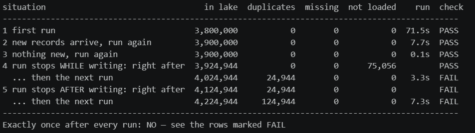
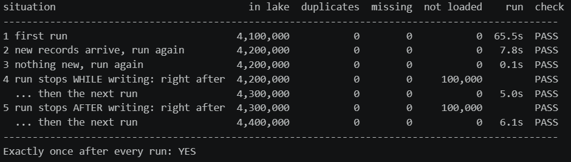
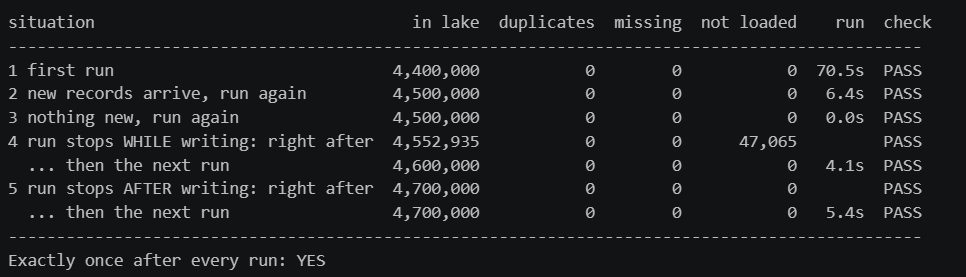

# Exercise 7: From the log to the lake

## Why the example fails

The example job calls `read_new(None)` on every run, so it always reads the topic
**from the beginning**. The first run is correct, but the second run copies all
2,000,000 records again, which gives 2,000,000 duplicates. The job has no idea
where it stopped last time.

## 1. Our decision: Architecture B — the lake is the truth

```python
def run_once_b():
    start = lake_position()  # stop point out state file
    new = read_new(start) # read niew record
    if new.count == 0:
        return
    run = write_files(new, STAGING) # write to staging 
    publish(run)    # in one rename to the lake
```
**Why B?**

- **One source of truth.** The lake holds bothe the data and position, so the two can never disagree. With A, they are kept in two places
- **All or nothing.** `publish` is a single rename, so readers never see half a run.
- **The lake itself is clean.** Any tool can read the files directly. Whith C, every has to use the dedup view and pay for it in every query.

**Trade-offs:** interrupted runs leave folders in `STAGING` that need cleaning up, and B relies on an atomic rename, whitch not all sotorages provide.

## 2. Result

- **A fails** because writing (to the lake) and remembering (in the state file) are two steps. A stop between them makes the next run write the batch again.
- **B passes** because a stopped run stays in STAGING, where it is invisible. The lake position does not change, so the next run reads the same records again and publishes them once. The "not loaded" count right after a stop is only lag, not lost data: missing is 0 everywhere.
- **C passes** only because the DEDUP_SQL view hides the duplicates. The files on disk still contain them.

## 3. Output of check_all(run_once)
**Architecture A**


**Architecture B**


**Architecture C**
